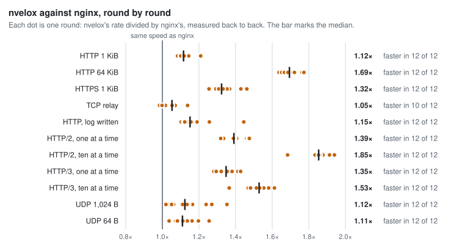
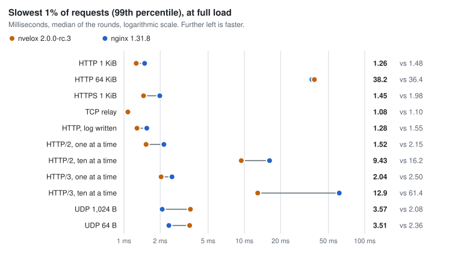
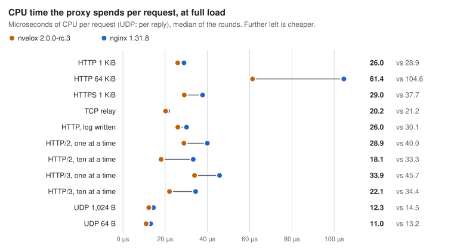
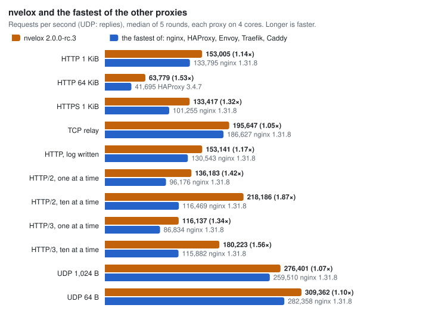
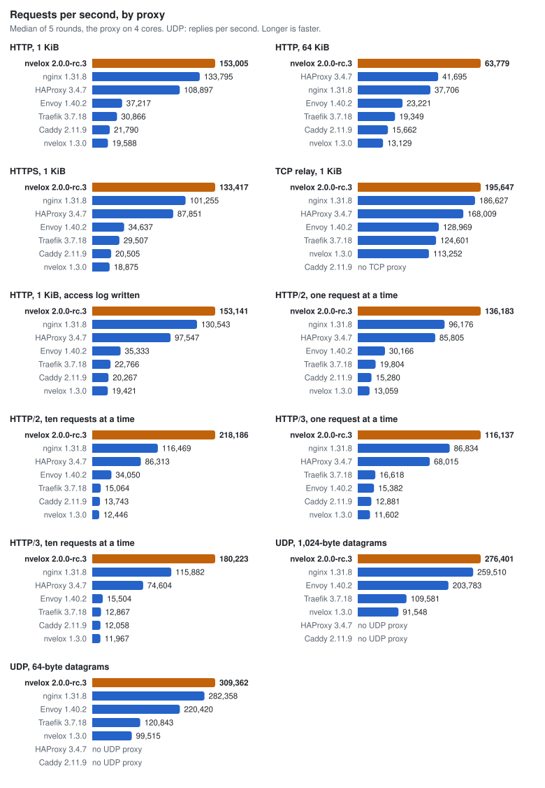
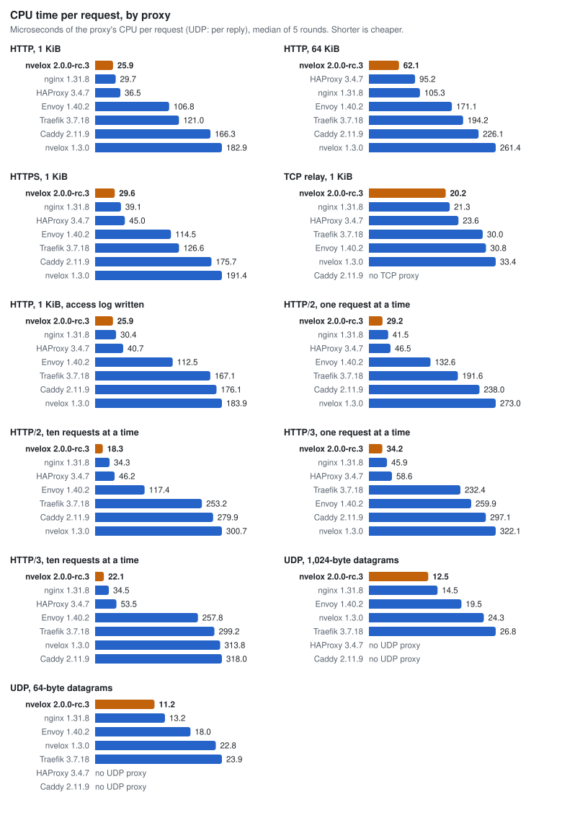
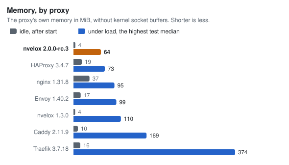
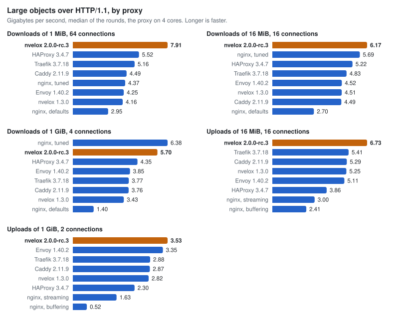
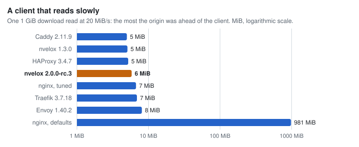

# nvelox 2.0.0-rc.3 against nginx 1.31.8 and 5 other proxies: results

Made by `bench.sh report` from the files in this directory. ../../README.md describes the tests.

### nvelox 2.0.0-rc.3 against nginx 1.31.8

Both are measured back to back in each of the 12 rounds, so every round gives one ratio. *Ratio* is the median of those ratios; *faster in* counts the rounds in which nvelox was the faster of the two. nvelox was the faster in 130 of the 132 paired measurements.

| Test | nvelox 2.0.0-rc.3 | nginx 1.31.8 | Ratio | Faster in | 99th percentile, ms | CPU per request, µs |
|---|---:|---:|---:|---:|---:|---:|
| HTTP, 1 KiB | 152,541 | 137,351 | 1.12× | 12 of 12 | 1.26 vs 1.48 | 26.0 vs 28.9 |
| HTTP, 64 KiB | 64,618 | 37,977 | 1.69× | 12 of 12 | 38.20 vs 36.39 | 61.4 vs 104.6 |
| HTTPS, 1 KiB | 136,272 | 105,101 | 1.32× | 12 of 12 | 1.45 vs 1.98 | 29.0 vs 37.7 |
| TCP relay, 1 KiB | 195,829 | 187,289 | 1.05× | 10 of 12 | 1.08 vs 1.10 | 20.2 vs 21.2 |
| HTTP, 1 KiB, access log written | 152,337 | 131,836 | 1.15× | 12 of 12 | 1.28 vs 1.55 | 26.0 vs 30.1 |
| HTTP/2, one request at a time | 137,823 | 99,955 | 1.39× | 12 of 12 | 1.52 vs 2.15 | 28.9 vs 40.0 |
| HTTP/2, ten requests at a time | 220,503 | 119,960 | 1.85× | 12 of 12 | 9.43 vs 16.20 | 18.1 vs 33.3 |
| HTTP/3, one request at a time | 117,297 | 87,243 | 1.35× | 12 of 12 | 2.04 vs 2.50 | 33.9 vs 45.7 |
| HTTP/3, ten requests at a time | 180,615 | 116,114 | 1.53× | 12 of 12 | 12.90 vs 61.42 | 22.1 vs 34.4 |
| UDP, 1,024-byte datagrams | 280,727 | 260,011 | 1.12× | 12 of 12 | 3.57 vs 2.08 | 12.3 vs 14.5 |
| UDP, 64-byte datagrams | 308,865 | 282,793 | 1.11× | 12 of 12 | 3.51 vs 2.36 | 11.0 vs 13.2 |

Rates are requests per second (UDP: replies per second), latency and CPU are nvelox vs nginx; all are medians of the rounds.

<picture><source media="(prefers-color-scheme: dark)" srcset="charts/ratio-dark.svg"></picture>

<picture><source media="(prefers-color-scheme: dark)" srcset="charts/latency-dark.svg"></picture>

<picture><source media="(prefers-color-scheme: dark)" srcset="charts/cpu-dark.svg"></picture>

### All proxies

Medians of the 5 rounds in which every proxy was measured (the first rounds of the same run). The best of each column is bold.

<picture><source media="(prefers-color-scheme: dark)" srcset="charts/lead-dark.svg"></picture>

<picture><source media="(prefers-color-scheme: dark)" srcset="charts/requests-dark.svg"></picture>

HTTP/1.1, HTTPS and TCP. Requests per second, median of 5 rounds:

| Proxy | HTTP 1 KiB | HTTP 64 KiB | HTTPS 1 KiB | TCP relay | HTTP, log written |
|---|---:|---:|---:|---:|---:|
| **nvelox 2.0.0-rc.3** | **153,005** | **63,779** | **133,417** | **195,647** | **153,141** |
| nginx 1.31.8 | 133,795 | 37,706 | 101,255 | 186,627 | 130,543 |
| HAProxy 3.4.7 | 108,897 | 41,695 | 87,851 | 168,009 | 97,547 |
| Envoy 1.40.2 | 37,217 | 23,221 | 34,637 | 128,969 | 35,333 |
| Traefik 3.7.18 | 30,866 | 19,349 | 29,507 | 124,601 | 22,766 |
| Caddy 2.11.9 | 21,790 | 15,662 | 20,505 | n/a | 20,267 |
| nvelox 1.3.0 | 19,588 | 13,129 | 18,875 | 113,252 | 19,421 |

HTTP/2 and HTTP/3. Requests per second, median of 5 rounds:

| Proxy | HTTP/2, one at a time | HTTP/2, ten at a time | HTTP/3, one at a time | HTTP/3, ten at a time |
|---|---:|---:|---:|---:|
| **nvelox 2.0.0-rc.3** | **136,183** | **218,186** | **116,137** | **180,223** |
| nginx 1.31.8 | 96,176 | 116,469 | 86,834 | 115,882 |
| HAProxy 3.4.7 | 85,805 | 86,313 | 68,015 | 74,604 |
| Envoy 1.40.2 | 30,166 | 34,050 | 15,382 | 15,504 |
| Traefik 3.7.18 | 19,804 | 15,064 | 16,618 | 12,867 |
| Caddy 2.11.9 | 15,280 | 13,743 | 12,881 | 12,058 |
| nvelox 1.3.0 | 13,059 | 12,446 | 11,602 | 11,967 |

UDP. Replies per second, median of 5 rounds:

| Proxy | UDP 1,024 B | UDP 64 B |
|---|---:|---:|
| **nvelox 2.0.0-rc.3** | **276,401** | **309,362** |
| nginx 1.31.8 | 259,510 | 282,358 |
| Envoy 1.40.2 | 203,783 | 220,420 |
| Traefik 3.7.18 | 109,581 (0.33% lost) | 120,843 |
| nvelox 1.3.0 | 91,548 (0.59% lost) | 99,515 |

### CPU and memory of every proxy

CPU time per request is the proxy's CPU time (user and kernel) over the measured window, divided by the requests it served; microseconds (UDP: per reply), median of the same 5 rounds. The lowest of each column is bold.

<picture><source media="(prefers-color-scheme: dark)" srcset="charts/cpu-all-dark.svg"></picture>

HTTP/1.1, HTTPS and TCP. CPU per request, µs:

| Proxy | HTTP 1 KiB | HTTP 64 KiB | HTTPS 1 KiB | TCP relay | HTTP, log written |
|---|---:|---:|---:|---:|---:|
| **nvelox 2.0.0-rc.3** | **25.9** | **62.1** | **29.6** | **20.2** | **25.9** |
| nginx 1.31.8 | 29.7 | 105.3 | 39.1 | 21.3 | 30.4 |
| HAProxy 3.4.7 | 36.5 | 95.2 | 45.0 | 23.6 | 40.7 |
| Envoy 1.40.2 | 106.8 | 171.1 | 114.5 | 30.8 | 112.5 |
| Traefik 3.7.18 | 121.0 | 194.2 | 126.6 | 30.0 | 167.1 |
| Caddy 2.11.9 | 166.3 | 226.1 | 175.7 | n/a | 176.1 |
| nvelox 1.3.0 | 182.9 | 261.4 | 191.4 | 33.4 | 183.9 |

HTTP/2 and HTTP/3. CPU per request, µs:

| Proxy | HTTP/2, one at a time | HTTP/2, ten at a time | HTTP/3, one at a time | HTTP/3, ten at a time |
|---|---:|---:|---:|---:|
| **nvelox 2.0.0-rc.3** | **29.2** | **18.3** | **34.2** | **22.1** |
| nginx 1.31.8 | 41.5 | 34.3 | 45.9 | 34.5 |
| HAProxy 3.4.7 | 46.5 | 46.2 | 58.6 | 53.5 |
| Envoy 1.40.2 | 132.6 | 117.4 | 259.9 | 257.8 |
| Traefik 3.7.18 | 191.6 | 253.2 | 232.4 | 299.2 |
| Caddy 2.11.9 | 238.0 | 279.9 | 297.1 | 318.0 |
| nvelox 1.3.0 | 273.0 | 300.7 | 322.1 | 313.8 |

UDP. CPU per request, µs:

| Proxy | UDP 1,024 B | UDP 64 B |
|---|---:|---:|
| **nvelox 2.0.0-rc.3** | **12.5** | **11.2** |
| nginx 1.31.8 | 14.5 | 13.2 |
| Envoy 1.40.2 | 19.5 | 18.0 |
| nvelox 1.3.0 | 24.3 | 22.8 |
| Traefik 3.7.18 | 26.8 | 23.9 |

*Memory under load* is the proxy's own memory (anonymous memory of its cgroup, the peak of each measurement), the lowest and the highest test median. *Idle* is 10 seconds of the freshly started proxy with no traffic.

<picture><source media="(prefers-color-scheme: dark)" srcset="charts/memory-dark.svg"></picture>

| Proxy | Memory under load, MiB | Idle memory, MiB | Idle CPU, % of one core | Threads or processes under load |
|---|---:|---:|---:|---:|
| **nvelox 2.0.0-rc.3** | 27 to 64 | 4.2 | 0.03 | 19 |
| nginx 1.31.8 | 84 to 95 | 37.1 | 0.00 | 5 |
| HAProxy 3.4.7 | 60 to 73 | 19.4 | 0.00 | 5 |
| Envoy 1.40.2 | 98 to 99 | 16.7 | 0.33 | 14 |
| Traefik 3.7.18 | 58 to 374 | 15.8 | 0.00 | 12 |
| Caddy 2.11.9 | 57 to 169 | 10.2 | 0.01 | 11 |
| nvelox 1.3.0 | 25 to 110 | 3.9 | 0.00 | 14 |

### Large objects

Plain HTTP/1.1, every proxy in each of 3 rounds. Downloads are files the origin holds in memory; uploads go to a sink that reads every body to its end. The figures are gigabytes per second (median of the rounds), with the proxy's CPU seconds per gigabyte in parentheses; the best of each column is bold.

nginx is measured twice in each direction. With its defaults it buffers: a response in temp files when the client is the slower side, and a whole request body before any of it goes upstream (its temp files are in memory in this test, so they cost no disk writes). *Tuned for large files* is `proxy_max_temp_file_size 0` with 16 buffers of 64k; *streaming* is `proxy_request_buffering off`. The other proxies run with the configuration of the request tests.

| Downloads | 1 MiB, 64 connections | 16 MiB, 16 connections | 1 GiB, 4 connections |
|---|---:|---:|---:|
| **nvelox 2.0.0-rc.3** | **7.91 (0.50)** | **6.17 (0.65)** | 5.70 (0.70) |
| HAProxy 3.4.7 | 5.52 (0.72) | 5.22 (0.77) | 4.35 (0.92) |
| Traefik 3.7.18 | 5.16 (0.75) | 4.83 (0.78) | 3.77 (0.86) |
| Caddy 2.11.9 | 4.49 (0.82) | 4.49 (0.83) | 3.76 (0.86) |
| nginx 1.31.8, tuned for large files | 4.37 (0.91) | 5.69 (0.70) | **6.38 (0.61)** |
| Envoy 1.40.2 | 4.25 (0.94) | 4.52 (0.88) | 3.85 (0.72) |
| nvelox 1.3.0 | 4.16 (0.83) | 4.51 (0.83) | 3.43 (0.95) |
| nginx 1.31.8, defaults | 2.95 (1.35) | 2.70 (1.48) | 1.40 (1.42) |
| *the origin alone* | *21.22* | *22.56* | *12.91* |

| Uploads | 16 MiB, 16 connections | 1 GiB, 2 connections |
|---|---:|---:|
| **nvelox 2.0.0-rc.3** | **6.73 (0.59)** | **3.53 (0.55)** |
| Traefik 3.7.18 | 5.41 (0.70) | 2.88 (0.70) |
| Caddy 2.11.9 | 5.29 (0.71) | 2.87 (0.71) |
| nvelox 1.3.0 | 5.25 (0.72) | 2.82 (0.72) |
| Envoy 1.40.2 | 5.11 (0.78) | 3.35 (0.59) |
| HAProxy 3.4.7 | 3.86 (1.04) | 2.30 (0.87) |
| nginx 1.31.8, streaming | 3.00 (1.33) | 1.63 (1.23) |
| nginx 1.31.8, buffering (its default) | 2.41 (1.66) | 0.52 (2.02) |
| *the sink alone* | *13.18* | *4.44* |

<picture><source media="(prefers-color-scheme: dark)" srcset="charts/large-dark.svg"></picture>

What the proxies held while they did this: for each figure the highest of the tests' medians (the proxies are freshly started before these tests).

| Proxy | Own memory, MiB | Kernel socket buffers, MiB | Temp files (in memory here), MiB |
|---|---:|---:|---:|
| **nvelox 2.0.0-rc.3** | 5 | 60 | none |
| nginx 1.31.8 (the four setups) | 52 | 71 | 2029 |
| HAProxy 3.4.7 | 20 | 46 | none |
| Envoy 1.40.2 | 69 | 92 | none |
| Traefik 3.7.18 | 47 | 50 | none |
| Caddy 2.11.9 | 25 | 73 | none |
| nvelox 1.3.0 | 14 | 50 | none |

**A client that reads slowly.** One 1 GiB download read at 20 MiB/s through each proxy, freshly started. A proxy that reads from the origin only as fast as its client takes the data holds a few megabytes; one that buffers holds the file.

| Proxy | Origin ahead of the client, at most | Own memory, at most | Temp files, at most | CPU for the whole download |
|---|---:|---:|---:|---:|
| Caddy 2.11.9 | 5 MiB | 12.5 MiB | none | 1.03 s |
| nvelox 1.3.0 | 5 MiB | 2.2 MiB | none | 1.00 s |
| HAProxy 3.4.7 | 5 MiB | 19.1 MiB | none | 0.96 s |
| **nvelox 2.0.0-rc.3** | 6 MiB | 3.7 MiB | none | 1.23 s |
| nginx 1.31.8, tuned for large files | 7 MiB | 37.5 MiB | none | 2.18 s |
| Traefik 3.7.18 | 7 MiB | 14.1 MiB | none | 1.13 s |
| Envoy 1.40.2 | 8 MiB | 17.8 MiB | none | 1.30 s |
| nginx 1.31.8, defaults | 981 MiB (the whole file after 2 s) | 36.4 MiB | 1,019 MiB | 3.10 s |

<picture><source media="(prefers-color-scheme: dark)" srcset="charts/slow-dark.svg"></picture>

## Checks on the test setup

- **The origin alone, HTTP 1 KiB**, at the start of every round: median 220,479 requests per second, from 199,857 to 291,139. It shows how much the machine's speed moves between rounds, which is why nvelox and nginx are compared within a round.
- **The UDP echo origin alone, 1,024 bytes:** median 400,859 replies per second, from 376,435 to 411,605.
- **Headroom:** the load generator used at most 507% of a core in any measurement, the origin at most 374%.
- **The origin was above 85% of its cores** while these ran, so their figures may be held back by the origin: nginx 1.31.8, TCP relay (349%); nvelox 2.0.0-rc.3, HTTP/2, ten at a time (374%); nvelox 2.0.0-rc.3, TCP relay (367%).
- **Proxies that did not use 90% of their cores** (median CPU of the measurements below that): Caddy 2.11.9, HTTP/2, one at a time (353%); Caddy 2.11.9, HTTP/3, ten at a time (358%); Caddy 2.11.9, HTTP 1 KiB (357%); Caddy 2.11.9, HTTP, log written (356%); Caddy 2.11.9, HTTP 64 KiB (355%); Caddy 2.11.9, HTTPS 1 KiB (359%); Envoy 1.40.2, UDP 64 B (343%); nginx 1.31.8, UDP 1,024 B (339%); nginx 1.31.8, UDP 64 B (326%); nvelox 2.0.0-rc.3, UDP 1,024 B (346%); nvelox 2.0.0-rc.3, UDP 64 B (345%); nvelox 1.3.0, HTTP/2, one at a time (356%); nvelox 1.3.0, HTTP 1 KiB (343%); nvelox 1.3.0, HTTP, log written (356%); nvelox 1.3.0, HTTP 64 KiB (337%); nvelox 1.3.0, HTTPS 1 KiB (356%); nvelox 1.3.0, UDP 1,024 B (219%); nvelox 1.3.0, UDP 64 B (224%); Traefik 3.7.18, HTTP, log written (358%); Traefik 3.7.18, UDP 1,024 B (294%); Traefik 3.7.18, UDP 64 B (290%).
- **Errors:** none: no failed request, no answer other than 2xx.
- **UDP datagrams lost:** Traefik 3.7.18, UDP 1,024 B, round 1: 0.35%; nvelox 1.3.0, UDP 1,024 B, round 1: 0.65%; nvelox 1.3.0, UDP 1,024 B, round 2: 0.67%; Traefik 3.7.18, UDP 1,024 B, round 2: 0.33%; Traefik 3.7.18, UDP 1,024 B, round 3: 0.35%; nvelox 1.3.0, UDP 1,024 B, round 3: 0.59%; Traefik 3.7.18, UDP 1,024 B, round 4: 0.33%; nvelox 1.3.0, UDP 1,024 B, round 4: 0.59%; Traefik 3.7.18, UDP 1,024 B, round 5: 0.33%; nvelox 1.3.0, UDP 1,024 B, round 5: 0.59%.
- **Protocol negotiated** in the HTTP/2 and HTTP/3 tests: h2 and h3 as asked, in every measurement.
- **Large objects, kernel socket buffers:** the highest single reading of any proxy was 93 MiB (Envoy 1.40.2, downloads of 16 MiB, round 3); the table shows medians of the rounds.
- **Large objects, failed transfers:** none.

## Setup

| | |
|---|---|
| Date | 2026-11-18T16:12:34Z |
| Machine | 20 CPUs, Intel(R) Xeon(R) Gold 6242R CPU @ 3.10GHz (VMware), 15.6 GiB RAM, Linux 6.8.0-149-generic |
| Cores | origin 4-7, proxy 8-11, load 12-19 |
| Settings | ROUNDS=12 FIELD_ROUNDS=5 DUR=10s WARM=3s BURNIN=180s CONNS=128 THREADS=8 WORKERS=4 LARGE_ROUNDS=3 LARGE_DUR=12s SLOW=1 |
| Proxies | nvelox 2.0.0-rc.3, nginx 1.31.8, HAProxy 3.4.7, Envoy 1.40.2, Traefik 3.7.18, Caddy 2.11.9, nvelox 1.3.0 |
| Load tools | wrk debian/4.1.0-4+b1 [epoll] Copyright (C) 2012 Will Glozer; h2load nghttp2/1.71.0; udptool (in this kit) |

`env.txt` has the image digests and the checksums of the binaries, the configs and the scripts of this run; `results.jsonl` one line per measurement (`large.jsonl` for the large objects, `slow.jsonl` the samples of the slow downloads); `tools.log` what the load tools printed.

## Every round

Requests (UDP: replies) per second. The origin alone is measured at the start of the round (for UDP: the echo origin, before the UDP tests).

**HTTP, 1 KiB**

| Round | Origin alone | nvelox 2.0.0-rc.3 | nginx 1.31.8 | Ratio |
|---:|---:|---:|---:|---:|
| 1 | 199,857 | 141,752 | 125,778 | 1.13 |
| 2 | 291,139 | 191,938 | 170,905 | 1.12 |
| 3 | 224,330 | 143,895 | 132,871 | 1.08 |
| 4 | 225,741 | 154,966 | 136,608 | 1.13 |
| 5 | 205,505 | 153,005 | 133,795 | 1.14 |
| 6 | 205,731 | 152,262 | 125,899 | 1.21 |
| 7 | 203,859 | 155,044 | 139,417 | 1.11 |
| 8 | 203,041 | 152,820 | 139,131 | 1.10 |
| 9 | 221,255 | 152,223 | 137,980 | 1.10 |
| 10 | 222,477 | 151,874 | 137,293 | 1.11 |
| 11 | 225,174 | 151,198 | 137,408 | 1.10 |
| 12 | 219,702 | 154,073 | 137,634 | 1.12 |

**HTTP, 64 KiB**

| Round | Origin alone | nvelox 2.0.0-rc.3 | nginx 1.31.8 | Ratio |
|---:|---:|---:|---:|---:|
| 1 | 199,857 | 61,724 | 37,706 | 1.64 |
| 2 | 291,139 | 81,223 | 47,270 | 1.72 |
| 3 | 224,330 | 63,779 | 38,248 | 1.67 |
| 4 | 225,741 | 64,879 | 36,809 | 1.76 |
| 5 | 205,505 | 63,633 | 37,386 | 1.70 |
| 6 | 205,731 | 62,647 | 36,582 | 1.71 |
| 7 | 203,859 | 61,927 | 37,491 | 1.65 |
| 8 | 203,041 | 65,741 | 39,040 | 1.68 |
| 9 | 221,255 | 65,961 | 38,319 | 1.72 |
| 10 | 222,477 | 64,356 | 38,616 | 1.67 |
| 11 | 225,174 | 65,094 | 36,715 | 1.77 |
| 12 | 219,702 | 65,462 | 38,832 | 1.69 |

**HTTPS, 1 KiB**

| Round | Origin alone | nvelox 2.0.0-rc.3 | nginx 1.31.8 | Ratio |
|---:|---:|---:|---:|---:|
| 1 | 199,857 | 126,912 | 101,255 | 1.25 |
| 2 | 291,139 | 172,823 | 120,975 | 1.43 |
| 3 | 224,330 | 133,417 | 105,759 | 1.26 |
| 4 | 225,741 | 132,943 | 97,236 | 1.37 |
| 5 | 205,505 | 141,406 | 96,765 | 1.46 |
| 6 | 205,731 | 134,787 | 101,951 | 1.32 |
| 7 | 203,859 | 137,756 | 106,596 | 1.29 |
| 8 | 203,041 | 140,878 | 106,347 | 1.32 |
| 9 | 221,255 | 131,303 | 100,394 | 1.31 |
| 10 | 222,477 | 131,401 | 104,718 | 1.25 |
| 11 | 225,174 | 142,702 | 105,483 | 1.35 |
| 12 | 219,702 | 141,564 | 106,309 | 1.33 |

**TCP relay, 1 KiB**

| Round | Origin alone | nvelox 2.0.0-rc.3 | nginx 1.31.8 | Ratio |
|---:|---:|---:|---:|---:|
| 1 | 199,857 | 195,003 | 171,422 | 1.14 |
| 2 | 291,139 | 269,801 | 254,991 | 1.06 |
| 3 | 224,330 | 197,181 | 187,951 | 1.05 |
| 4 | 225,741 | 189,745 | 186,627 | 1.02 |
| 5 | 205,505 | 195,647 | 186,407 | 1.05 |
| 6 | 205,731 | 186,878 | 189,825 | 0.98 |
| 7 | 203,859 | 198,782 | 188,085 | 1.06 |
| 8 | 203,041 | 196,010 | 186,304 | 1.05 |
| 9 | 221,255 | 186,763 | 175,990 | 1.06 |
| 10 | 222,477 | 197,847 | 184,929 | 1.07 |
| 11 | 225,174 | 190,038 | 190,354 | 1.00 |
| 12 | 219,702 | 198,057 | 188,057 | 1.05 |

**HTTP, 1 KiB, access log written**

| Round | Origin alone | nvelox 2.0.0-rc.3 | nginx 1.31.8 | Ratio |
|---:|---:|---:|---:|---:|
| 1 | 199,857 | 143,913 | 130,543 | 1.10 |
| 2 | 291,139 | 191,317 | 132,415 | 1.44 |
| 3 | 224,330 | 150,602 | 131,744 | 1.14 |
| 4 | 225,741 | 153,141 | 121,725 | 1.26 |
| 5 | 205,505 | 153,661 | 129,214 | 1.19 |
| 6 | 205,731 | 150,623 | 131,652 | 1.14 |
| 7 | 203,859 | 151,264 | 135,376 | 1.12 |
| 8 | 203,041 | 155,440 | 133,506 | 1.16 |
| 9 | 221,255 | 152,511 | 121,352 | 1.26 |
| 10 | 222,477 | 152,163 | 132,828 | 1.15 |
| 11 | 225,174 | 152,604 | 131,929 | 1.16 |
| 12 | 219,702 | 148,982 | 132,754 | 1.12 |

**HTTP/2, one request at a time**

| Round | Origin alone | nvelox 2.0.0-rc.3 | nginx 1.31.8 | Ratio |
|---:|---:|---:|---:|---:|
| 1 | 199,857 | 134,864 | 92,353 | 1.46 |
| 2 | 291,139 | 136,183 | 92,621 | 1.47 |
| 3 | 224,330 | 139,340 | 99,968 | 1.39 |
| 4 | 225,741 | 128,277 | 96,176 | 1.33 |
| 5 | 205,505 | 137,823 | 99,941 | 1.38 |
| 6 | 205,731 | 137,824 | 99,697 | 1.38 |
| 7 | 203,859 | 139,712 | 94,726 | 1.47 |
| 8 | 203,041 | 136,007 | 101,892 | 1.33 |
| 9 | 221,255 | 135,833 | 103,008 | 1.32 |
| 10 | 222,477 | 140,962 | 100,277 | 1.41 |
| 11 | 225,174 | 139,492 | 100,100 | 1.39 |
| 12 | 219,702 | 140,222 | 101,022 | 1.39 |

**HTTP/2, ten requests at a time**

| Round | Origin alone | nvelox 2.0.0-rc.3 | nginx 1.31.8 | Ratio |
|---:|---:|---:|---:|---:|
| 1 | 199,857 | 196,144 | 116,469 | 1.68 |
| 2 | 291,139 | 218,186 | 112,818 | 1.93 |
| 3 | 224,330 | 204,969 | 109,185 | 1.88 |
| 4 | 225,741 | 223,153 | 120,370 | 1.85 |
| 5 | 205,505 | 232,995 | 120,124 | 1.94 |
| 6 | 205,731 | 219,343 | 119,887 | 1.83 |
| 7 | 203,859 | 225,511 | 121,164 | 1.86 |
| 8 | 203,041 | 219,298 | 119,976 | 1.83 |
| 9 | 221,255 | 221,663 | 120,869 | 1.83 |
| 10 | 222,477 | 225,283 | 122,834 | 1.83 |
| 11 | 225,174 | 217,631 | 113,785 | 1.91 |
| 12 | 219,702 | 222,272 | 119,943 | 1.85 |

**HTTP/3, one request at a time**

| Round | Origin alone | nvelox 2.0.0-rc.3 | nginx 1.31.8 | Ratio |
|---:|---:|---:|---:|---:|
| 1 | 199,857 | 103,105 | 76,756 | 1.34 |
| 2 | 291,139 | 112,277 | 87,652 | 1.28 |
| 3 | 224,330 | 116,137 | 82,236 | 1.41 |
| 4 | 225,741 | 119,600 | 88,435 | 1.35 |
| 5 | 205,505 | 118,309 | 86,834 | 1.36 |
| 6 | 205,731 | 116,929 | 88,815 | 1.32 |
| 7 | 203,859 | 115,755 | 89,429 | 1.29 |
| 8 | 203,041 | 115,186 | 85,046 | 1.35 |
| 9 | 221,255 | 119,561 | 86,596 | 1.38 |
| 10 | 222,477 | 118,146 | 82,782 | 1.43 |
| 11 | 225,174 | 118,714 | 89,312 | 1.33 |
| 12 | 219,702 | 117,666 | 89,025 | 1.32 |

**HTTP/3, ten requests at a time**

| Round | Origin alone | nvelox 2.0.0-rc.3 | nginx 1.31.8 | Ratio |
|---:|---:|---:|---:|---:|
| 1 | 199,857 | 156,585 | 106,614 | 1.47 |
| 2 | 291,139 | 170,349 | 114,965 | 1.48 |
| 3 | 224,330 | 184,703 | 115,882 | 1.59 |
| 4 | 225,741 | 183,629 | 116,346 | 1.58 |
| 5 | 205,505 | 180,223 | 118,190 | 1.52 |
| 6 | 205,731 | 174,442 | 115,552 | 1.51 |
| 7 | 203,859 | 183,769 | 118,259 | 1.55 |
| 8 | 203,041 | 181,007 | 114,505 | 1.58 |
| 9 | 221,255 | 163,062 | 119,445 | 1.37 |
| 10 | 222,477 | 183,968 | 120,124 | 1.53 |
| 11 | 225,174 | 183,231 | 113,662 | 1.61 |
| 12 | 219,702 | 176,836 | 116,835 | 1.51 |

**UDP, 1,024-byte datagrams**

| Round | Origin alone | nvelox 2.0.0-rc.3 | nginx 1.31.8 | Ratio |
|---:|---:|---:|---:|---:|
| 1 | 376,435 | 284,556 | 224,089 | 1.27 |
| 2 | 401,650 | 276,401 | 223,111 | 1.24 |
| 3 | 401,400 | 272,270 | 259,510 | 1.05 |
| 4 | 411,605 | 272,894 | 263,727 | 1.03 |
| 5 | 404,607 | 303,397 | 260,512 | 1.16 |
| 6 | 395,513 | 295,143 | 258,278 | 1.14 |
| 7 | 407,023 | 304,567 | 268,305 | 1.14 |
| 8 | 394,350 | 287,662 | 212,673 | 1.35 |
| 9 | 402,888 | 293,533 | 264,268 | 1.11 |
| 10 | 400,319 | 272,049 | 256,286 | 1.06 |
| 11 | 397,280 | 274,762 | 261,583 | 1.05 |
| 12 | 399,057 | 276,897 | 271,558 | 1.02 |

**UDP, 64-byte datagrams**

| Round | Origin alone | nvelox 2.0.0-rc.3 | nginx 1.31.8 | Ratio |
|---:|---:|---:|---:|---:|
| 1 | 376,435 | 282,788 | 243,584 | 1.16 |
| 2 | 401,650 | 309,362 | 279,397 | 1.11 |
| 3 | 401,400 | 329,205 | 283,229 | 1.16 |
| 4 | 411,605 | 292,739 | 282,358 | 1.04 |
| 5 | 404,607 | 322,269 | 291,539 | 1.11 |
| 6 | 395,513 | 313,707 | 276,148 | 1.14 |
| 7 | 407,023 | 303,527 | 241,816 | 1.26 |
| 8 | 394,350 | 307,045 | 287,599 | 1.07 |
| 9 | 402,888 | 317,540 | 285,579 | 1.11 |
| 10 | 400,319 | 307,498 | 286,650 | 1.07 |
| 11 | 397,280 | 308,368 | 284,876 | 1.08 |
| 12 | 399,057 | 328,644 | 274,566 | 1.20 |
