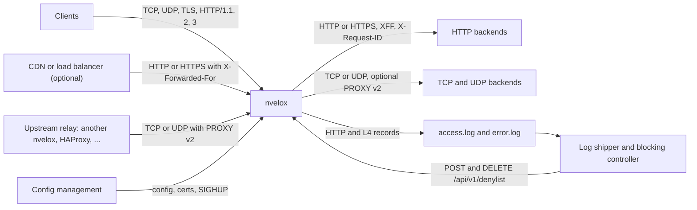
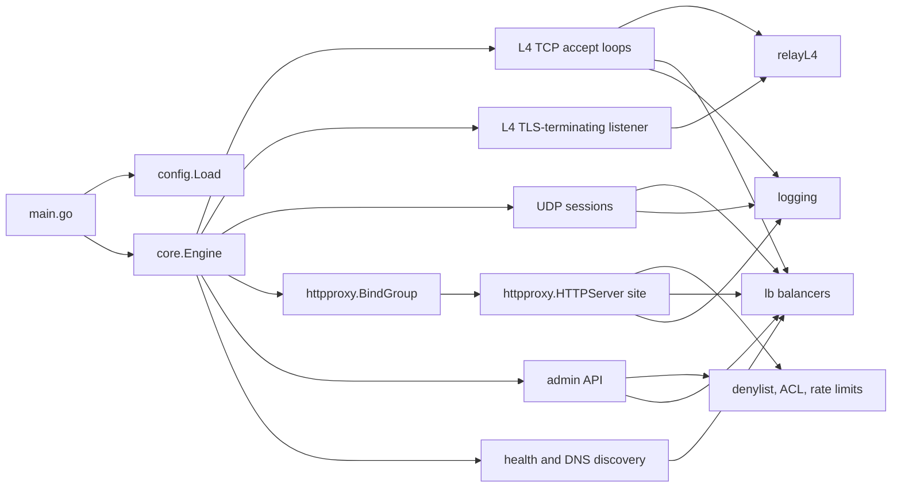
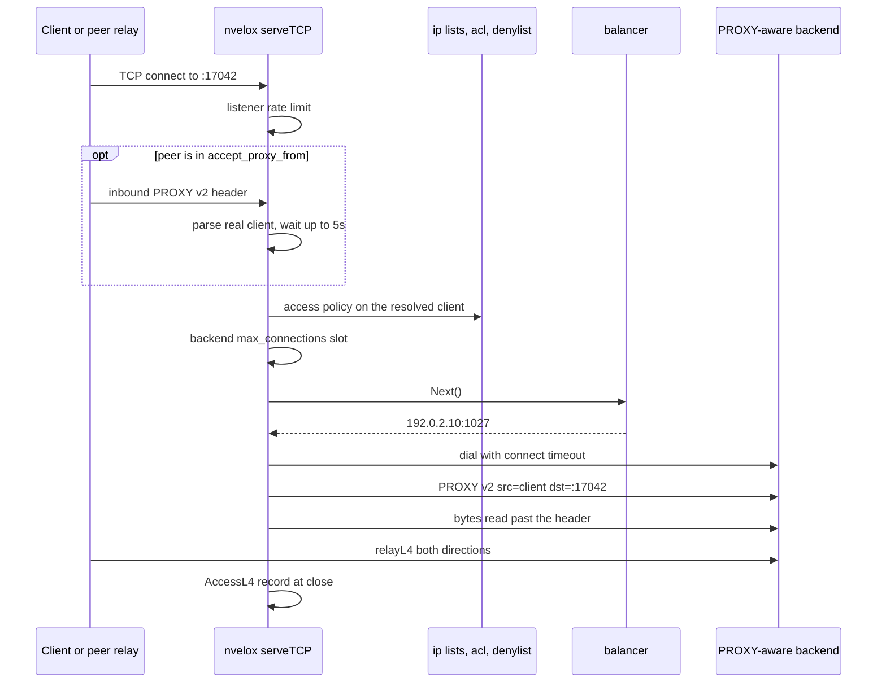
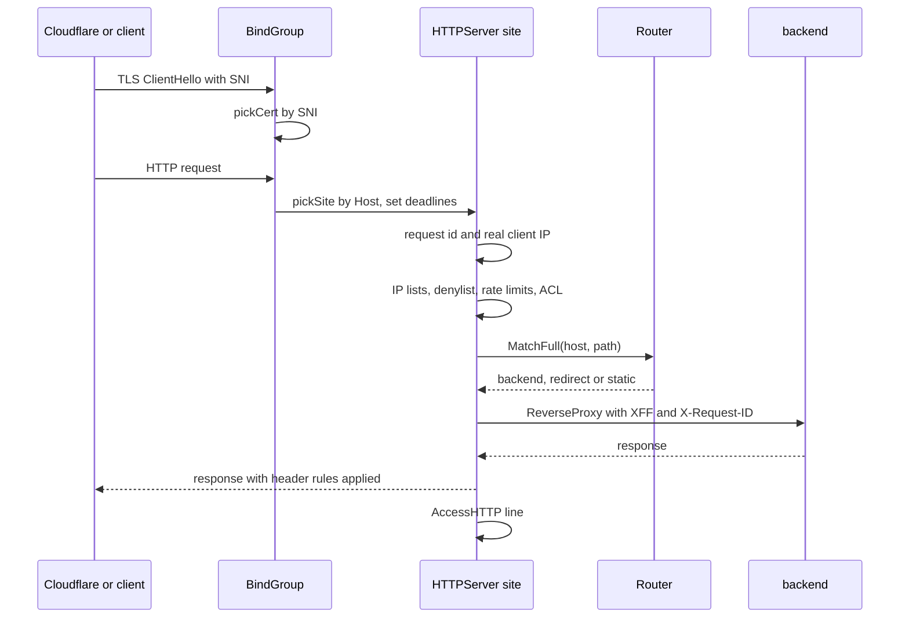
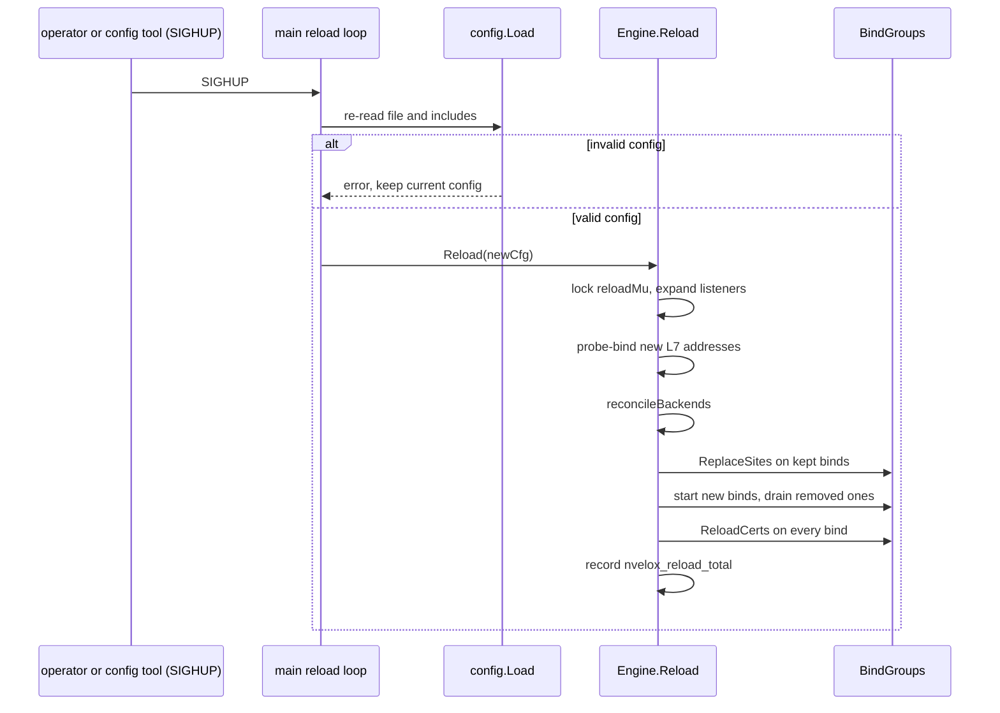
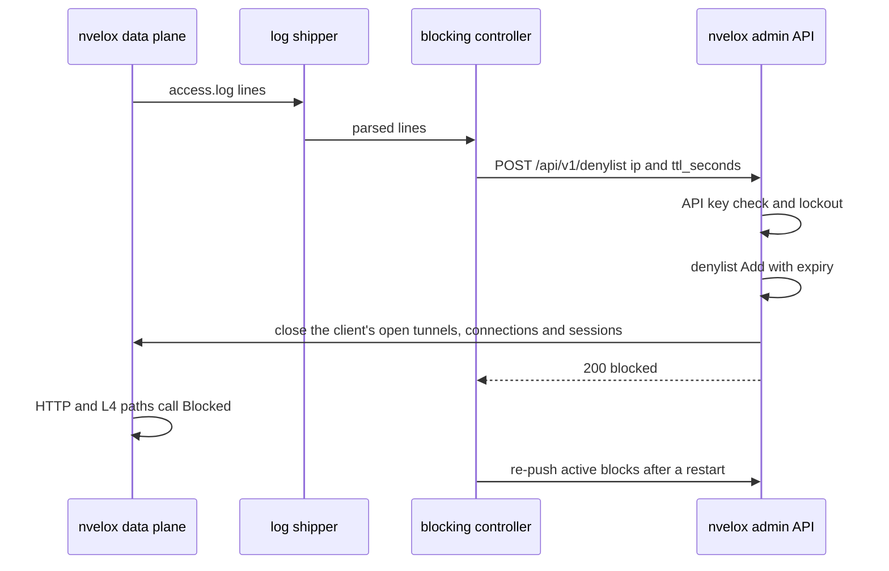

# nvelox architecture

nvelox is a single-binary L4/L7 proxy and load balancer written in Go. It listens on TCP, UDP, HTTP and HTTPS ports (plus optional HTTP/3), forwards each connection or request to a backend pool, and adds PROXY protocol v2, TLS termination, Host/SNI and path routing, ACLs, rate limits and a runtime IP denylist. Typical deployments: an edge proxy that terminates TLS for web sites, an L4 forwarder that hands the client address to its backends with PROXY v2, and chains of nvelox relays. An external controller can push IP blocks into it through the admin API.

## At a glance

| | |
|---|---|
| Role | L4/L7 reverse proxy and load balancer; also the data plane of the nvelox Kubernetes ingress controller |
| Language / runtime | Go 1.26 or newer (`go.mod`), one static binary built with `CGO_ENABLED=0` (`Dockerfile:18`, `.goreleaser.yaml:6-7`) |
| Entrypoint | `main.go:25`: parse `-config`, `config.Load`, start `core.Engine`, handle SIGHUP and SIGUSR1 (`main.go:40-121`, `core/procsignal`) |
| Listeners | Declared in config: `tcp`, `udp`, `http`, `https`, single port or range (`config/config.go:103-195`, `core/engine.go:588-655`). HTTP/3 over QUIC on `https` binds with `http3: true` (`core/httpproxy/bindgroup.go:358-379`). Admin REST API on `admin.bind`, loopback `127.0.0.1:9091` when empty (`core/admin/api.go:121-155`), Prometheus text on `metrics.bind`, loopback `127.0.0.1:9090` when empty (`core/engine.go:152-167`, `core/controlplane.go`) |
| State | In memory only: runtime denylist, balancer and health status, sticky sessions, UDP sessions, rate-limit buckets, response cache. Nothing is persisted |
| Main dependencies | `pires/go-proxyproto`, `quic-go/quic-go` (HTTP/3 where event loops are not supported, and its HTTP/3 client in the tests), `yookoala/gofast` (FastCGI, built from the copy in `third_party/gofast`), `gopkg.in/yaml.v3` (`go.mod:5-12`). No database, Redis or queue client |

## Context

- **Clients, CDNs and load balancers.** A site behind a CDN or load balancer lists its address ranges in `trusted_proxies`, so the real client comes from `X-Forwarded-For` (`core/httpproxy/server.go`).
- **Relays.** A listener accepts an inbound PROXY v2 header only from peers in `accept_proxy_from` (`proxy/trust.go`): TCP and UDP listeners, and HTTP and HTTPS listeners on every HTTP version. A relay must send the header: on every connection to a TCP, HTTP or HTTPS listener (a LOCAL header for its own traffic, such as health checks) and in every UDP datagram. On an HTTP or HTTPS listener the header comes before any byte of TLS or HTTP, and the client it names is the connection's peer for the IP lists, the dynamic denylist, the rate limits, the ACL, the access log, `X-Forwarded-For` and `trusted_proxies`. A relay's connection without a header, or with one that does not parse or verify, is closed and counted (`nvelox_proxy_header_rejected_total`, by reason: `missing`, `malformed`, `signature`, `timeout`); a relay's connection that brings no byte at all, such as a TCP health check, is closed like any silent client's and not counted. The sites of one bind address share one relay list, key file and `accept_proxy_replay_window`, and a reload applies a change of any of them to their new connections (`core/httpproxy/proxyaccept.go`). Over TCP the handshake proves the peer address; over UDP a datagram's source can be forged. A receiver can therefore require signed headers (`accept_proxy_key_file`; a sending nvelox signs with `send_proxy_key_file`) or trust headers only on chosen interfaces (`accept_proxy_interfaces`, UDP); a UDP listener that trusts by address alone starts with a warning.
- **HTTP/3 through a UDP relay.** An https listener with `http3` and `accept_proxy_from` takes a relay's datagrams only with their header (`core/httpproxy/h3relay.go`). A datagram from a relay must start with a header that names a datagram client and is signed over the datagram (`accept_proxy_key_file` is required with `http3`: the configuration is refused without it); the header is taken off before QUIC sees the packet, and QUIC answers the relay, which answers the client. A relay's socket is pinned to the client its header named: a datagram from it that names another client is dropped until the pin has been unused for 60 s. The requests of such a connection carry that client as their peer, as on the other HTTP versions. Datagrams that do not pass are dropped and counted in `nvelox_proxy_header_rejected_total` (reasons `missing`, `malformed`, `signature`, `replayed`, `client_changed`, `table_full`; a socket's table holds 65,536 relay sockets). A pin also holds its relay socket's window of counters (signature version 2): it outlives the pin's 60 s for the client until the pin is removed, more than 60 s after the socket's last datagram that passed. Other addresses reach QUIC unchanged. On the event loops (Linux) a connection keeps the client it began with: a datagram that names another one is never taken for it, also when the pin has run out. Relays and direct clients share the batched path there, and the relays are asked for at every datagram, so a reload that changes `accept_proxy_from` holds for HTTP/3 from the next datagram on, as it does for HTTP/1.1 and HTTP/2. Where the `quic-go` server serves HTTP/3, it reads its socket through a layer that does this: a request on a relay's connection for which no client is pinned is answered 403; QUIC reads and writes one datagram per system call on such a socket, for direct clients too (a separate bind address for the relays keeps the batched path for the others); and the layer is put in when the listener starts with relays, so adding `accept_proxy_from` to a running HTTP/3 listener by reload takes effect for HTTP/3 at the next restart (a warning says so).
- **Interface-bound relay trust.** For `accept_proxy_interfaces`, each address of a listed interface gets a UDP socket on the listener's port, bound to the interface (`SO_BINDTODEVICE`); the kernel hands such a socket only datagrams that arrived on that interface. Only sessions that arrive on these sockets may have a relay's header trusted. A datagram that claims a relay's address but arrives on another interface reaches the listener's ordinary socket and is a client like any other. The sockets share the port with `SO_REUSEPORT`, which only a socket of the same user can join (see UDP on the event loops). A program on the machine can also send from the machine's own addresses, and Linux files such a datagram under the interface that has the address: `accept_proxy_from` should not include the machine's addresses (a startup warning names them), and where untrusted programs run there, signed headers are the protection. Interfaces and their addresses are read at start (`core/udpdevice.go`).
- **Signed PROXY headers.** The signature is a TLV of type `0xE4`. Version 1: version (1 byte, `1`), Unix time in seconds (8 bytes, big-endian) and an HMAC-SHA256 (32 bytes) over the string `nvelox PROXY v2 signature v1`, the timestamp, the transport-protocol byte, the source and destination address (16 bytes each, IPv4 as IPv4-mapped) and ports (2 bytes each, big-endian), and for a datagram the payload after the header. Version 2 binds a header to the relay socket that sent it: version (`2`), time (8 bytes), a counter (8 bytes) and an HMAC over `nvelox PROXY v2 signature v2`, the time, the counter, the port the header comes from as the receiver sees it (the source port of its datagram or connection, 2 bytes), then what version 1 covers. A signature is valid within 30 s of the receiver's clock; any key of the receiver's file is accepted, and a reload re-reads the file (`proxy/signature.go`, `core/proxytrust.go`). nvelox signs in version 2 (`send_proxy_key_file`): each of its sockets to a backend counts its headers from the clock in nanoseconds at the first one, one more for each, so a socket opened later on the same port counts on above it; a connection's one header has counter 0. A receiver takes both versions, or only version 2 with `accept_proxy_replay_window: required`. For a version 2 datagram it keeps a window of the last 64 counters of each relay socket (address and port): a counter taken before, or below the window, is dropped and counted as `replayed` (`nvelox_udp_dropped_total`; for HTTP/3 `nvelox_proxy_header_rejected_total`). A copy from another port fails the signature. A relay socket's window outlives its sessions: it is kept until 60 s after the last one that used it ended, when no header it took can pass its time check any more, so a copy cannot begin a session either; for HTTP/3 it is kept with the socket's pin. A UDP listener keeps the windows on each event loop (a relay socket's datagrams to one address reach one loop), the goroutine path on each listener socket. A copy sent to another receiver that trusts the same relays with the same key, another listener or another nvelox, is new to that receiver: give receivers their own keys where that matters (`send_proxy_key_file` is set per backend). A version 1 datagram can be replayed unchanged inside its 30 s by someone on the path, also from another source port, and each replay can open a session. A header must name the transport it arrives on (a signed stream header is refused in a datagram, and the reverse), and each UDP datagram is signed with the backend's current key, so a reload that rotates it applies to running sessions. nvelox 1.3.0 and older, and 2.0.0-rc.3 and older, refuse version 2: upgrade the receivers before the senders, then set `required`.
- **PROXY-aware backends.** With `send_proxy_v2: true` the backend receives the client address. The header's destination is the address the client dialed, so one backend socket can serve a whole port range and tell the ports apart (`core/l4tcp.go`, `core/handler.go`). A client and an address of different IP families (a relay names an IPv4 client to an IPv6 listener address, or the reverse) go as IPv6, the IPv4 address in its IPv4-mapped form (`::ffff:203.0.113.7`), as HAProxy writes it. A UDP datagram never goes to such a backend without the header, where a client could put one of its own first: a session whose header cannot be built for its client is refused, and a reload that changes `send_proxy_v2` ends the backend's open UDP sessions (`nvelox_udp_dropped_total{reason="no_backend_header"}` and `"send_proxy_changed"`). A relay's header names a datagram's client by an IP address; one for a stream or with a socket path names none.
- **PROXY-aware HTTP backends.** On HTTP and HTTPS listeners the header starts every connection nvelox opens to a `send_proxy_v2` backend, before the TLS handshake of a `backend_tls` one (`core/httpproxy/proxysend.go`). It names the client of the connection the request came in on: its TCP peer, the client a trusted relay named, or an HTTP/3 client's UDP address written as a TCP one (the backend's connection is a stream); the destination is the address that client connected to. The protocol gives a connection one client, so a backend connection serves one client connection: that client's later requests reuse it, no other client's request ever does, and it is closed with it. The streams of an HTTP/2 or HTTP/3 connection share its backend connections and open more while they run at once. How many idle ones a client connection keeps follows what it uses: on the event loops as many as it had in use at the same time in the last 5 to 10 seconds, and never fewer than four, so a steady load of streams, or the next burst, reopens nothing, and a client that has gone quiet is back at four within ten seconds; on the `net/http` path four for each backend it uses. The ones unused the longest are closed first, and every idle one after 90 s. With `send_proxy_key_file` each header is signed when its connection is opened. Active HTTP health checks of such a backend start with a LOCAL header (`core/health/checker.go`): the backend expects a header on every connection, and the check has no client to name. A TCP check connects and closes without sending anything, for every backend.
- **Log consumers.** The access log has one line per HTTP response and per L4 connection or UDP session (see Operating it). A shipper can forward it, and a controller can push blocks back through the admin API (see Key flows).
- **Config management.** Whatever renders the config sends SIGHUP to reload certificates, sites and backends, and restarts nvelox for L4 listener changes (see Config reload).

## Inside

| Package | Responsibility | Key files |
|---|---|---|
| `main` | Flags, config load, logger init, gateway id, engine start, SIGHUP / SIGUSR1 loop | `main.go:40-137` |
| `config` | YAML schema, `include:` merge, defaults, validation | `config/config.go:516-585`, `config/config.go:587-767`, `config/config.go:800-898` |
| `core` (engine) | Builds backends, opens every listener, reload, graceful stop | `core/engine.go:112-357`, `core/engine.go:366-573`, `core/engine.go:712-858` |
| `core` (L4) | TCP accept loops, TLS L4, half-close relay, UDP sessions (event loops, or one reading goroutine per socket), PROXY trust, listener rate limiter | `core/l4tcp.go`, `core/relay.go`, `core/l4fast.go`, `core/udpfast.go` (both with package `relay` of the ngx module), `core/udpsock.go`, `core/handler.go`, `core/udpsession.go`, `core/proxytrust.go`, `core/ratelimit.go` |
| `core/httpproxy` | One socket per bind address with SNI cert and Host site selection, then the per-site request pipeline: router, request id, cache, compression, static files, FastCGI | `core/httpproxy/bindgroup.go:20-613`, `core/httpproxy/server.go:387-789`, `core/httpproxy/router.go:86-131`, `core/httpproxy/requestid.go:69-85` |
| `lb` | `roundrobin` (default), `leastconn` and `random` over the healthy set | `lb/lb.go:16-45` |
| `core/health`, `core/discovery` | Active TCP or HTTP probes. DNS re-resolve that drops private IPs unless `allow_private_ips` is set | `core/health/checker.go:36-131`, `core/discovery/dns.go:87-145` |
| `core/denylist` | Process-wide IP and CIDR denylist with TTL | `core/denylist/denylist.go:28-228` |
| `core/admin` | REST API: stats, backends, drain or enable or disable, denylist | `core/admin/api.go:121-517` |
| `core/acl`, `core/middleware` | ACL rules, CIDR lists, per-IP token buckets | `core/acl/acl.go:28-197`, `core/middleware/ipratelimit.go:24-138` |
| `core/circuitbreaker`, `core/sticky`, `core/passivehealth.go`, `core/connlimit.go` | Per-backend breaker, sticky store, passive failure counting, concurrency cap. The breaker, sticky store and passive health are used on the HTTP path only; the concurrency cap (`max_connections`) also bounds L4 TCP connections and UDP sessions | `core/httpproxy/server.go:595-611`, `core/httpproxy/server.go:696-750`, `core/l4tcp.go`, `core/handler.go` |
| `core/logging` | Error log, HTTP and L4 access-log formats, log file modes and reopen | `core/logging/logger.go:95-288`, `core/logging/reopen.go` |
| `core/metrics` | Small Prometheus text registry | `core/metrics/metrics.go:19-197` |
| `core/tlsutil` | TLS version and cipher policy, client-certificate policy (`LoadClientAuth`), SNI wildcard matching | `core/tlsutil/clientauth.go`, `core/tlsutil/sni.go:13-94` |
| `proxy` | PROXY v2 header writer for UDP datagrams | `proxy/proxy_protocol.go:26-105` |

Present but not wired into the engine: `core/sni` (SNI passthrough router), `core/throttle`, `core/scripting` (Lua) and `core/tlsutil/ocsp.go`. No non-test code imports these packages or calls these functions. Their config keys (`sni_routes`, `throttle`, `routes[].scripts`, `tls.ocsp_stapling`) are rejected at load (see Configuration).

### Concurrency model

| Plane | Model | Code |
|---|---|---|
| Event loops (Linux) | One loop per GOMAXPROCS, each a goroutine driving its own epoll instance: edge-triggered registrations, non-blocking sockets read and written with `recvfrom`, `sendto` and `sendmsg`, a timing wheel with 5 ms ticks, and a task queue woken through an eventfd. A connection belongs to one loop for its whole life, so its state takes no locks. Listeners are bound with `net.Listen` as before; their socket is then moved out of the Go poller and shared by all loops (`EPOLLEXCLUSIVE`), and accepted connections are spread round-robin. A loop is locked to its own OS thread and does not yield to the Go scheduler: when the loops start, the scheduler is given one more slot per loop (`GOMAXPROCS` is raised by the number of loops), so the goroutines beside the loops (TLS handshakes, requests served by `net/http`, health checks) never wait for a slot a loop holds. | the module `github.com/nvelox/ngx` |
| Plain L4 TCP | On Linux the event loops relay both directions of a session, with the semantics of `relayL4`: half-close, at most 16 KiB in flight per direction, the idle timeout, reading and dropping the client's input once the backend stopped accepting it (so its response still arrives), PROXY v2 to the backend, access checks and the L4 access record. Connections from a trusted PROXY relay (`accept_proxy_from`), and every connection on other platforms, use the goroutine relay: one `net.Listen` and one accept goroutine per (expanded) listener, one goroutine per connection plus one more inside `relayL4` for the second direction, blocking copies with pooled 16 KiB buffers. Accept errors back off from 5 ms to 1 s | `core/l4fast.go` (the relay itself: package `relay` of the ngx module), `core/engine.go:226-245`, `core/l4tcp.go:42-70`, `core/relay.go:45-50`, `core/relay.go:88-101` |
| L4 TLS termination | `tcp` listener with `tls.cert`: `net.Listen`; a trusted relay's PROXY header is read off the raw stream first, then `tls.Server` runs the handshake on it. The handshake, with any `client_auth` check, completes before the backend is dialed. Same accept loop and relay | `core/engine.go` |
| UDP | On Linux the event loops serve the listeners (see UDP on the event loops): a session belongs to one loop and takes no lock and no goroutine. On other platforms one goroutine per listener socket reads the datagrams and hands them to the session handler (`OnOpen`, `OnData`, `OnClose`), with one goroutine per session for the backend's replies. Either way sessions are capped (16,384 per process, 512 per client IP) | `core/udpfast.go` (the relay itself: package `relay` of the ngx module), `core/udpsock.go`, `core/handler.go`, `core/udpsession.go`, `core/udpread_unix.go` |
| HTTP, HTTPS, HTTP/3 | On Linux, HTTP/1.1 and HTTP/2 run on the event loops (see "HTTP/1.1 on the event loops" and "HTTP/2 on the event loops"), HTTPS once the TLS handshake, run in a goroutine as before, has settled the protocol. The Go `net/http` server of the bind address (a goroutine per connection) serves upgrades and every HTTP/1.1 connection the event loops hand over, and its handlers serve the HTTP/2 and HTTP/3 requests the loops pass to them. HTTP/3 runs on the event loops as well, on nvelox's own QUIC transport (see "HTTP/3 on the event loops"); on other platforms an optional `quic-go` server serves it. Site set and certificates live behind `atomic.Pointer`, so requests never take a lock to find their site | `ngx/web` (event loops), `core/httpproxy/fasthost.go`, `core/httpproxy/bindgroup.go:20-41`, `core/httpproxy/bindgroup.go:323-400` |
| Background | Per-backend health checker and DNS resolver, sticky, cache and per-IP limiter cleanup loops, denylist sweeper (1 min), UDP pool sweeper (30 s; for the sessions of `core/udpsock.go`) | `core/engine.go:712-776`, `core/engine.go:147`, `core/udppool.go:106-118` |
| Reload and shutdown | `reloadMu` serialises SIGHUP reloads and is held through `Start` until listeners are up. Shutdown stops the HTTP bind groups, all at the same time (requests in flight get up to `server.shutdown_timeout`, 10 s by default), then closes the L4 listeners, waits for accept loops, closes live L4 conns and waits up to 30 s for `ActiveConns`. The process ends when that is done; a second SIGINT or SIGTERM ends it at once | `core/engine.go`, `main.go` |

## Key flows

### TCP connection proxied with PROXY v2

- The listener rate limiter runs first. Then the access policy (`ip_denylist`, the dynamic denylist, `ip_allowlist`, source-IP `acl`, in that order) runs on the resolved client: the peer for a direct client; for a trusted relay, the client its PROXY v2 header names (read before anything is dialed), or the relay itself for a LOCAL header. A relay's connection that does not start with a valid header is closed (`core/proxytrust.go`). A trusted relay's own IP is never checked for the clients it relays (`core/l4tcp.go`, `core/l4access.go`). Backend `max_connections` is taken next, one slot per session.
- A server entry without a port gets the listener's port. The dial timeout is the backend's `timeouts.connect`, else the listener's, else 10 s (`core/l4tcp.go:146-172`, `config/config.go:362-371`).
- For a trusted peer, nvelox reads the inbound v2 header off the stream before anything is dialed, waiting at most 5 s (10 s on a TLS-terminating listener) and reading not one byte past it. A LOCAL header makes the relay itself the client; a connection whose header is missing, does not parse or, with `accept_proxy_key_file`, is not validly signed is closed (`core/proxytrust.go`, `core/l4tcp.go`, `core/engine.go`).
- The outbound header's destination is the address the client dialed, not nvelox's ephemeral source, on plain and on TLS-terminating listeners alike. That lets a backend serve a whole listener port range on one socket and tell the ports apart by the header (`core/l4tcp.go`, `core/engine.go`).
- `relayL4` forwards everything already read before half-closing the other side (TCP `CloseWrite`, or `close_notify` plus FIN for TLS). Only an RST, a failed write or the idle timeout (default 5 min) aborts both sides (`core/relay.go:16-41`, `core/relay.go:54-62`, `core/relay.go:108-131`, `core/relay.go:188-194`).
- At close one L4 record is written: `ok` or `no_route`. Byte counts are always 0. No record is written for a trusted relay whose real client was never resolved (`core/l4tcp.go:126-143`, `core/logging/logger.go:256-271`).

UDP follows the same rules. The outbound v2 header is built once per session and prepended to every datagram. Behind a trusted relay every datagram must carry an inbound header naming the same client: it is stripped, the client is admitted (access policy and per-client session cap) on the session's first datagram, and datagrams without a valid header or naming another client are dropped (`core/handler.go`, `core/proxytrust.go:136-149`). TLS-terminating TCP listeners apply the same policy, reading a trusted relay's PROXY header off the raw stream before the handshake, and complete the handshake (and any `client_auth` check) before the backend is dialed (`core/engine.go`).

### HTTP request routed to a backend

- One socket per bind address. `GetCertificate` picks the certificate by SNI: exact name, then wildcard, then the default site's cert. ALPN offers `h2` and `http/1.1`, and TLS defaults to versions 1.2 to 1.3 (`core/httpproxy/bindgroup.go:420-445`, `core/httpproxy/bindgroup.go:578-603`, `core/tlsutil/clientauth.go:105-128`).
- The site is chosen by Host: exact, then leftmost wildcard, then `default_server`, else the first site. Per-site read and write deadlines are set here (default 60 s each) (`core/httpproxy/bindgroup.go:107-131`, `core/httpproxy/bindgroup.go:149-203`, `core/httpproxy/bindgroup.go:237-257`).
- The ACL, the router and the access log see the decoded request path in canonical form: dot segments resolved, duplicate slashes merged (`core/httppath/httppath.go`, `HTTPServer.ServeHTTP`). When canonicalizing changed the path, the backend receives the canonical path; otherwise it receives the path as the client encoded it (an encoded `%2F` inside a segment is kept). The cache key uses the path as sent upstream. Matching is case-sensitive; use `path_regex` with `(?i)` for a case-insensitive backend. A backslash, raw or as `%5C`, is not a path separator: it is passed to the backend unchanged, as nginx and Envoy do by default. nvelox itself never treats it as one: FastCGI script names and try_files targets that contain it are refused (400), and static files are looked up by the literal name. A backend that treats `\` as `/` must normalise paths itself, or ACL rules must also cover the backslash spelling.
- A static route serves files under its root: dotfile paths, scripts (`.php`, `.phtml`, `.phar`) and symlinks out of the root count as missing; a directory serves its first index file, or with `autoindex` an HTML listing of what the route would serve (escaped names, a CSP that runs no script, at most 10,000 entries) (`core/httpproxy/static.go`, `core/httpproxy/autoindex.go`).
- The real client IP is the peer, unless the peer is in `trusted_proxies`. Then nvelox walks every `X-Forwarded-For` line right to left, skipping trusted hops; a hop may carry a port or brackets. A hop that does not parse stops the walk at the nearest trusted hop (or the peer). All IP checks and the access log use this address (`HTTPServer.realClientIP`).
- Gates in order: static `ip_denylist`, dynamic denylist (403), `ip_allowlist`, listener `rate_limit` (applied per request here), `ip_rate_limit` (429), ACL with optional custom status, CONNECT (405), body limit, response cache (`HTTPServer.ServeHTTP`). `0.0.0.0/0` in `ip_allowlist`, `ip_denylist` or an ACL `source_ip` means every client, IPv6 included. A deny rule also matches the path with `;params` removed.
- Routes match first-wins on exact host, path prefix or regex, and can redirect, serve static files or FastCGI, or rewrite. Without a match the listener `backend` is used (`core/httpproxy/router.go:86-131`, `core/httpproxy/server.go:482-585`).
- Proxying (`core/httpproxy/proxy.go`) adds the connection cap, the sticky target, the circuit breaker (asked before each attempt), retries, and `X-Forwarded-For`, `X-Real-IP` and `X-Forwarded-Proto`; from a peer outside `trusted_proxies` the other forwarding headers (`Forwarded`, `X-Forwarded-Host`, `CF-Connecting-IP`, ...) are removed. Headers are set after the client's hop-by-hop headers are removed, so a `Connection:` token cannot strip them. Only failures the backend caused count for passive health and the breaker: not a client that went away (logged 499), a body over `max_body_size` (413), a stalled body (408) or the listener's read timeout (504). `retry.on` is honoured (empty means `connect_failure`); a request is resent only if it never reached the backend with its body untouched, or if it has no body and an idempotent method. WebSocket upgrades go through the same `httputil.ReverseProxy` and transport (so `backend_tls` applies); the connection is hijacked only after a 101 that switches to WebSocket, other `Upgrade` values are stripped, and a failed upgrade closes the client connection. Backend dials time out after 10 s, and the transport keeps up to 256 idle connections per host (`HTTPServer` construction in `core/httpproxy/server.go`).

### HTTP/1.1 on the event loops (Linux)

A plain HTTP/1.1 connection, or an HTTPS one whose handshake settled on HTTP/1.1, is served by an event loop (package `web` of the ngx module; `core/httpproxy/fasthost.go` gives it nvelox's sites, relays and log). Each request takes the steps of the flow above, in the same order and with the same results, without a goroutine, a header map or an allocation on the common path.

- **Parsing.** The parser accepts a strict subset of HTTP/1.1: `HTTP/1.1` only, an origin-form target with ordinary bytes, one `Host`, at most one valid `Content-Length`, no `Transfer-Encoding`, `Expect` or `Upgrade`, no obs-fold or bare LF, and a head of at most 32 KiB. It was checked against `net/http` by differential fuzzing (`core/httpproxy/fastparse.go`).
- **Hand-over.** Everything else goes to the bind address's `net/http` server, at a request boundary and for the rest of the connection, with the bytes already read replayed (`handoffListener`, `prefixConn`). Over TLS, `net/http` gets the plaintext stream and the connection's TLS state through `ConnContext`. Handed over are:
  - requests outside the parser's subset: HTTP/1.0, CONNECT, WebSocket and other upgrades, h2c, chunked request bodies, and bodies larger than `max_body_size`;
  - sites with a response cache, compression or `client_auth`;
  - static, FastCGI, redirect, `try_files` and `expires` routes;
  - backends with sticky sessions;
  - for a `backend_tls` backend: gRPC requests (they need HTTP/2 to the backend), and every request when its TLS configuration could not be loaded (answered 502, never sent in plaintext).
  An HTTPS connection that arrives on a bind address where any site asks for client certificates goes to `net/http` straight after the handshake, whatever its protocol.
- **Same behaviour.** Site selection, the canonical path, IP lists, the dynamic denylist, rate limits, the ACL, routes, forwarding headers (with the `trusted_proxies` walk), request IDs, header rules, `X-Content-Type-Options`, `Alt-Svc`, content-type sniffing, error pages, retries, the circuit breaker, passive health, `max_connections` and every timeout behave as on the `net/http` path. The access-log line is byte for byte the same; it is formatted without allocating and written once per loop iteration. Tests run the same requests through both paths and compare the results (`core/httpproxy/fast_linux_test.go`).
- **Upstream.** Each loop keeps its own keep-alive connections per site, backend and server address. How many idle ones it keeps follows the load: as many as were in use at the same time in the last 5 to 10 seconds, so that a steady load, however large, reopens nothing; never fewer than 256 per address divided among the loops (at least 16 per loop), which is what the `net/http` path keeps. An idle connection is closed after 90 s, or when it is returned to a pool that needs fewer. How many connections are open at once is decided by the requests in flight, which a backend's `max_connections` bounds. A site never reuses a connection another site opened, and pools left empty are dropped once a minute. Connects are non-blocking, and backend host names are resolved off the loop. Responses are framed by `Content-Length`, chunked encoding (re-chunked to the client) or the backend's close. A stale keep-alive connection is retried once when the request can be replayed, as Go's `Transport` does.
- **TLS to backends** (`backend_tls`). The connect and the TLS handshake run on a goroutine (the connect timeout, then 10 s for the handshake, as on the `net/http` path); the connection then moves to the loop, where its TLS records are read and written, and into the same keep-alive pools as plain connections. The certificate is checked exactly as on the `net/http` path, against `backend_tls.server_name` or else the host of the server's address. HTTP/1.1 only. A new connection resumes the TLS session of an earlier one of the same site and backend. A failed handshake counts as a connect failure: retried under `retry.on: connect_failure` and counted by passive health and the circuit breaker.
- **Response heads.** A backend's response head is read as `net/http` reads it, also when it is unusual or malformed: lines end in CRLF or a bare LF, with any number of fields, up to 10 MiB; folded lines are joined with one space; `Transfer-Encoding` is honoured from HTTP/1.1 on and only as a single `chunked`; a repeated `Content-Length` must repeat the same text; a chunked response cannot announce a framing field as a trailer; `Pragma: no-cache` without `Cache-Control` adds `Cache-Control: no-cache`. Generated heads are compared with `net/http` in the tests. The fast path differs on purpose in four cases, each stated by a test (`TestRespHeadKnownDifferences`, `TestRespConnectionCloseWithNames`): a status code below 100 is answered 502 (net/http ends the client's connection); the hop-by-hop fields of an informational response are left out; fields named in `Connection` are left out also when it says `close`; a field named `Close` in an HTTP/1.0 response is kept.
- **Large response heads.** A loop parses a head itself up to 64 KiB, 96 fields and 8 header names in `Connection`. A head past any of these is parsed on a goroutine, where the client's head is built from it too, while the backend connection waits. A site has one such head worked on at a time, and one or two are worked on in all, so another site's head waits for at most the one being parsed. The backend's `response_header` limit stops once its whole head has arrived. So the time a loop spends on one response head is bounded by a 64 KiB head, whatever a backend sends (`parseOffLoop`, `core/httpproxy/fast_backend_linux_test.go`).
- **Taking turns.** A connection that always has more to relay gives way to the loop's other connections after 256 KiB (a TCP session after 1 MiB per direction) and goes on right after them. A chunked body goes out as one chunk per read, however small the backend's chunks are, and chunk framing that carries next to no data is refused as `net/http` refuses it (more than 16 KiB of it).
- **Request bodies** (`Content-Length`) are streamed with back-pressure. A body is never sent twice once part of it reached a backend. When a backend answers before it has read the whole body, the client connection is closed after that response.
- **A client that stalls.** `timeouts.write` runs while output waits for the client, and starts again after every 32 KiB the client takes. `timeouts.read` runs while a request body waits for the client, not while it waits for the backend. While a response waits to be taken, nothing more is read from that client. `net/http` gets the same results through its deadlines.
- **A failure stays with its connection.** If the code that serves a connection panics, that connection is closed and the panic is logged with its stack, as `net/http` does for a handler; the loop and its other connections go on (`TestLoops_PanicContained`). The same holds for HTTP/2, HTTP/3 and QUIC connections, for backend connections, whose request ends with them, and for the sessions of the TCP and UDP relays, nvelox's own code included (the access policy, the PROXY header): a panic for one datagram ends that client's session, and the other datagrams read with it are relayed (`TestTCP_PanicEndsOneSession`, `TestUDP_PanicEndsOneSession` in the engine). The connection's socket and its place among the server's connections are given back even when the panic came from the code that closes it, so a graceful stop never waits for it (`TestLoops_PanicWhileClosing`). Each panic is written to the error log, tagged `[HTTP]`, `[CONN]` or `[UDP]`, with its value stripped of control characters and with its stack, and counted in `nvelox_recovered_panics_total{protocol}` (`http`, `http2`, `http3`, `quic`, `tcp`, `udp`; every series is there at 0 from the start, so an alert on its increase fires on the first panic: `core/panics.go`).
- **Shutdown and reload** work as `http.Server.Shutdown` does: stop accepting, close idle connections, end active ones after their response, and close the rest at the deadline. On SIGINT or SIGTERM the process ends only when that is done, so a request in flight is answered, on HTTP/1.1, HTTP/2 and HTTP/3 alike; a request that never ends (an event stream, a long download) is closed at the deadline, `server.shutdown_timeout` (10 s unless set). Nothing new is accepted on the HTTP ports meanwhile, so that setting is also the longest such a request can hold up a restart: where another instance takes the traffic a long wait costs nothing, a single instance may want a short one. HTTP/3 connections are told to send nothing new (GOAWAY) and stay until one second after their last answer, so that it is delivered (on the event loops a connection closes as soon as its client has acknowledged that answer); a client that is gone is not waited for (`core/httpproxy/bindgroup.go`, `stopHTTP3`; `h3conn_linux.go`, `closeWhenDelivered`). Every request reads the bind address's current site set, so a reload applies to the next request.

### HTTP/2 on the event loops (Linux)

An HTTPS connection whose handshake settled on `h2` is served by an event loop too (package `web` of the ngx module). Its frames are read and written on the loop, every stream is one request of the flow above on the same keep-alive pools to the backends as HTTP/1.1, and everything that leaves for the client in one pass of the loop is encrypted and written once, at the end of that pass. The rules of the protocol, the limits and the error a broken rule gets are those of Go's HTTP/2 server, which served these connections before; tests send the same frames to both and compare the answers (`core/httpproxy/h2conn_linux_test.go`).

- **Requests on the loop.** A request is served on the loop when HTTP/1.1 would serve it there: a method other than CONNECT, a path with ordinary bytes, at most 96 fields and 32 KiB, a body only with a `Content-Length`, a site and route the loops serve. Its fields go through the HTTP/1.1 engine's own rules; cookie fields reach the backend as one `Cookie` header, and names as `net/http` writes them (`Content-Type`). Backends are still spoken to in HTTP/1.1.
- **Requests for the handlers.** Every other request (a static file, FastCGI, a redirect, a site with a cache or compression, a sticky backend, a body without a length, announced trailers, `Expect`, a field HTTP/2 does not allow, a header list past its limits) runs in a goroutine through the bind address's `net/http` handler, as before. The handler gets the request Go's HTTP/2 server would have built and a `ResponseWriter` that behaves like that server's: a 4 KiB buffer, a `Content-Length` for a response that fits in it, a sniffed `Content-Type`, trailers, `Flush`, read and write deadlines. What it writes is posted to the loop as frames; the request body reaches it through a pipe the loop fills, and the client gets its flow-control window back as the handler reads. A handler waits for the loop only until its own stream's output has left; the loop never waits for a handler (`core/httpproxy/h2bridge_linux.go`).
- **Flow control.** A response's data beyond the client's stream or connection window waits in the stream, and its backend is not read meanwhile; streams that wait for the connection's window send one frame each in turn. A request body is passed to the backend as it arrives, and the client's window is given back as the backend takes it.
- **Limits, as Go's server has them:** 250 streams per connection, 1 MiB receive windows for a stream and for the connection, a header list of at most 1 MiB + 320 bytes and 500 fields (431 above), 10 s for the client's preface and 2 s for its first SETTINGS frame, the bind address's idle timeout (GOAWAY, then the close 1 s later), and at most 250 handlers at a time per connection with up to 1,000 more waiting (a client that keeps resetting what it asks for is cut off with ENHANCE_YOUR_CALM). The frame size is the protocol's 16,384 bytes.
- **A client that stalls or floods.** With more than 64 KiB of output waiting for the client, no backend of the connection is read; with more than 256 KiB waiting, none of its frames are read either, so answers to its frames (PING, SETTINGS, resets) cannot pile up. A connection whose client takes no output for `timeouts.write` is closed; a stream whose client opens no window for that long is reset; `timeouts.read` applies to a request body as on HTTP/1.1 (408). A request reset by the client in the same input that brought it never reaches a backend.
- **One connection cannot stop the others.** A connection takes at most 64 KiB of input before it gives way to the loop's other connections. Three more rules apply that Go's server does not have: a header block must be finished within the bind address's header timeout (`read_header`); a client that resets its requests before any answer, each within 1 s of opening it, is cut off with ENHANCE_YOUR_CALM once 250 of its first 500 streams ended that way, or half of all its streams after that; and frames that do nothing (an empty DATA frame that ends nothing, an empty CONTINUATION frame, frames for a closed stream) are counted, and more than 1,000 of them that also outnumber the connection's completed streams end it the same way.
- **Where the loops differ from Go's HTTP/2 server**, each stated by a test: a SETTINGS frame that would push a stream's window past the largest value ends the connection at once (Go: when that window is next used); a HEADERS frame with more padding than payload ends the connection (Go resets the stream and keeps a header table that missed the block); `Keep-Alive`, `Proxy-Connection`, `Upgrade` and `Transfer-Encoding` added by a response header rule are not sent (clients that check their input refuse a response that carries them); an informational response carries the backend's fields only; a response that breaks off has reached the client as far as it had arrived (Go's handler may still have held its first 4 KiB).

### HTTP/3 on the event loops (Linux)

An `https` listener with `http3: true` is served over QUIC by the same loops (package `web` of the ngx module). The QUIC transport is nvelox's own (`ngx/quic`): it does no I/O, a loop hands it datagrams and the time and sends what it has to say. HTTP/3 itself is `ngx/h3` (frames, and QPACK with the static table only). Every request stream is one request of the flow above, on the keep-alive pools to the backends that HTTP/1.1 and HTTP/2 use; a request the loops do not serve themselves runs through the bind address's `net/http` handler, as on HTTP/2. On other platforms the `quic-go` server serves HTTP/3; tests run the same requests against both (`core/httpproxy/h3conn_linux_test.go`, `http3_test.go`).

- **Sockets and loops.** One UDP socket per loop, all bound to the address with `SO_REUSEPORT`; the kernel gives a client's datagrams to one of them, always the same one, so a connection lives on one loop and takes no lock. A pass of a loop reads up to 64 datagrams a call (`recvmmsg`); what its connections have to send leaves at the end of the pass (`sendmmsg`). A datagram is never fragmented on its way out (`IP_PMTUDISC_DO`).
- **Handshakes** run on a goroutine each (TLS 1.3 through `crypto/tls`), so that a signature does not hold a loop up; the loop takes the connection over when the handshake is complete. A loop runs at most 4,096 unfinished handshakes, each for 10 s at most. While fewer than 128 of them are with clients whose address is not proven, a new client is taken on trust; past that it is sent a Retry packet and served when it comes back with the token (good for 10 s, from the same address). Sessions resume with tickets; 0-RTT is not offered. QUIC version 1; a client that offers another is told so. One client address, an IPv4 address or an IPv6 /64 (behind a trusted relay, the client it names), may have `server.http3.handshakes_per_source` of them running on a loop, 32 by default: the first packets of its further clients are dropped and counted (`nvelox_h3_handshakes_refused_total{reason="per_source"}`) until one of its handshakes completes or is given up.
- **A client that moves.** A datagram from another address than the connection sends to is served, and the connection follows once the client has answered a challenge sent to the new address (3 such addresses at a time; one that has been silent for 5 s gives way to a new one). A client that moves on purpose has new connection IDs to do it with. A datagram that reaches another loop's socket is passed to the loop that has the connection.
- **Loss and congestion.** Loss detection and probe timeouts are RFC 9002's; the congestion controller is CUBIC (RFC 9438) with pacing, and a window that grows only while it is in use. A connection starts with a window of 32 datagrams, as the quic-go server does (RFC 9002 recommends ten): the first 38 KB of an answer are on their way before the client has acknowledged anything. Keys are updated every 2^20 packets.
- **Datagram size.** 1,200 bytes, which every path carries, until a connection has sent 64 KiB. Then it finds out what its path carries: a datagram of 1,452 bytes with nothing in it, then 1,392, 1,350, 1,300, 1,252, each tried twice, none larger than the client accepts. Two probe timeouts in a row, or eight large datagrams lost while smaller ones arrive, take it back to 1,200 on that path; a client that moves starts over (`ngx/quic/mtu.go`).
- **What a connection holds to send** follows its congestion window: twice the window, at least 256 KiB and at most `server.http3.max_send_buffer` (16 MiB by default, which holds the largest window there is), and no more than its client's flow-control limits let it send. The connections of the process together hold at most `server.http3.max_send_memory`, by default an eighth of its memory (the machine's, or its control group's limit; 64 MiB at the least); past that a connection takes 16 KiB at a time.
- **Requests.** A client may have 100 requests open. Of a request's body it may have sent 1 MiB that the backend has not taken, and of all its requests together as much. For an upload that its backend takes as fast as the path brings it these two windows double, up to `server.http3.max_stream_receive_window` and `max_connection_receive_window` (6 MiB and 15 MiB by default, the quic-go server's numbers), so that an upload over a long path is not held to a mebibyte per round trip; a request's window grows only while the connection's can be one and a half times as large. A client is given its next limit when it has used a quarter of a window (the quic-go server's rule), so it always has three quarters of one to go on with. What the connections of the process are granted beyond their first windows is at most `server.http3.max_receive_memory`, by default an eighth of its memory. A request is served on the loop when HTTP/2 would serve it there; every other request runs in a goroutine through the `net/http` handler (`core/httpproxy/h3bridge_linux.go`), at most 100 at a time per connection. A request waits when that many handlers still run (those of requests their client has reset have to notice first), and a client with more than 400 requests waiting is cut off (H3_EXCESSIVE_LOAD).
- **A request's head** may be `server.http3.max_header_size` (64 KiB by default), counted as HTTP/3 counts it (names, values and 32 bytes a field); a larger one is answered 431, at the frame's header already when the frame announces more. It is to be complete within the listener's `read_header` (408 after it), and nothing is set aside for what a frame merely announces. HTTP/1.1 and HTTP/2 take 1 MiB.
- **The limits are settings** (`server.http3`, `core/httpproxy/h3limits.go`). A connection has the ones in force when it was opened and keeps them: its settings told the client the largest head, and its transport was given its send buffer and how far its windows grow. A reload therefore changes them for the connections opened after it, and the two totals of the process at once.
- **Socket buffers.** Each loop's UDP socket asks the kernel for `server.http3.socket_buffer` (4 MiB by default) to receive and as much to send, in the order the quic-go server asks: the plain request, which the kernel cuts to `net.core.rmem_max` and `wmem_max`; then, only if the socket has less than was asked for, the forced one, which a process with `CAP_NET_ADMIN` is granted. A burst of a fast client's datagrams waits in the receive buffer until its loop reads it, and what does not fit is dropped: with the kernel's default limit (208 KiB) a fast upload loses datagrams and slows down. A listener whose sockets got less than was asked for says so in a startup warning that names the kernel limit (`quicBufferWarning`). The size is read when a bind address starts.
- **Timeouts.** A connection without a request for the listener's `timeouts.idle` (120 s by default) is told that no more requests are served and is closed, as on HTTP/1.1 and HTTP/2. The same time is the QUIC idle timeout (30 s when `timeouts.idle` is 0, and the client's own when that is shorter): a connection from which nothing at all arrives for that long is dropped. `timeouts.read` and `timeouts.write` apply to a request body and to a response its client does not take, as on HTTP/2.
- **Stopping.** The client is told that no new request is served (GOAWAY), the open ones finish, and a connection closes when its client has acknowledged the last answer, one second after that answer at the latest.
- **Relays.** A listener that trusts UDP relays takes a relay's datagram only with its signed header, which names the client; the header is taken off before anything else reads the datagram (see "HTTP/3 through a UDP relay" above).
- **Where the loops differ from the quic-go server**, each stated by a test: a response that breaks off short of its `Content-Length` resets the stream (H3_INTERNAL_ERROR) instead of ending as if it were whole; an interim response (103 Early Hints) is passed on as the backend sent it, without its hop-by-hop fields, and the fields nvelox adds to every response go on the answer alone; a 204 carries no `Content-Length`; trailers larger than the head's limit reset the stream (H3_EXCESSIVE_LOAD); a head with more than 500 fields is answered 431, as on HTTP/1.1 and HTTP/2; a head that is not complete in time is answered 408; a connection without a request is closed after `timeouts.idle` (the quic-go server keeps one for as long as its client keeps it alive, and drops a silent one after 30 s); a stop closes a connection as soon as its last answer is acknowledged; a path that stops carrying large datagrams is noticed.

### UDP on the event loops (Linux)

UDP listeners are served by the same loops (the relay of the ngx module, with `core/udpfast.go` deciding for it who gets a session, where it goes and what is logged). What a listener does is unchanged: the order of admission, the session caps, the relay rules, the timeouts and the access records are those of the session handler (`core/handler.go`), which serves UDP on other platforms from one reading goroutine per socket (`core/udpsock.go`).

- **Sockets.** A single port (and a range with fewer ports than loops) has one socket per loop, all bound to the port with `SO_REUSEPORT`. The kernel hands every datagram of one client (address and port) to the same socket, so a session lives on one loop and needs no lock. A range with at least as many ports as loops has one socket per port, the ports dealt to the loops in turn. The sockets of `accept_proxy_interfaces` are made the same way, bound to their interface. Every socket is bound at start, before the process gives up root, and read once serving begins.
- **Who can share the port.** Linux lets a socket join a port shared with `SO_REUSEPORT` only when it belongs to the same user as the sockets already there; it would then receive a part of the datagrams. The sockets are made before nvelox switches to `server.user`, so when nvelox starts as root only root can join. Started as an ordinary user, other programs of that user could. A second nvelox on the same port is refused at start: a plain bind checks that the port is free before the shared sockets are made.
- **One client, one loop.** A client's datagrams are spread over the loops by the kernel's hash of its address and port: one very busy client is served by one loop, and with few clients some loops get more than others.
- **Batches.** A loop reads a socket with `recvmmsg` (up to 16 datagrams a call). The replies it collects from the backend sockets during a pass leave with one `sendmmsg` per listener socket at the end of the pass. A session's backend socket is a connected socket on the same loop; a reply costs one read. Relaying a datagram and its reply allocates nothing.
- **A full send buffer.** A datagram the backend socket cannot take at once, or a reply the listener socket cannot take, is dropped and counted (`nvelox_udp_dropped_total{reason="backend_busy"}` and `"client_busy"`), as the network drops what does not fit. Without event loops the session's goroutine waits in both cases.
- **Timeouts** run on the loop's timer wheel (5 ms steps): a session keeps the time of its client's last datagram and of its backend's last reply, and its timer looks at them when it fires; a datagram touches no timer.
- **Backends by host name** are looked up off the loop; the datagrams that arrive meanwhile are kept apart (up to 1 MiB) and sent one by one, in order. Without event loops they are sent as one datagram.
- **Relays.** A trusted relay's datagram that starts with the very header that admitted its session is relayed without parsing it again; with `accept_proxy_key_file` every header is parsed and its signature checked, and a counter it carries is taken in its relay socket's window.

### Config reload (SIGHUP)

- SIGHUP is caught in `main`. The log files are reopened first, then the config is reloaded; a config that fails to parse or validate is logged and the running config stays. SIGUSR1 only reopens the log files, for logrotate (`main.go:87-121`, `core/logging/reopen.go`).
- The reload is all-or-nothing for new L7 bind addresses: each is probe-bound before anything changes (`core/engine.go:366-401`, `core/engine.go:476-501`).
- Kept backends keep their balancer (least-conn counts), sticky store and breaker, and only swap the server list. Removed backends have their goroutines stopped (`core/engine.go:784-858`).
- Kept bind groups swap their site set atomically, so in-flight requests finish on the old site. Removed groups drain for up to 10 s in the background (`core/engine.go:505-562`, `core/httpproxy/bindgroup.go:276-317`).
- Certificates are re-read for every site. A file that fails to load keeps the previous cert (`core/httpproxy/bindgroup.go:494-551`). A certificate renewal therefore needs only a SIGHUP.
- Not reloaded, so they need a restart: L4 TCP, TLS and UDP listeners and their per-listener settings, listener `rate_limit`, logging settings (the files themselves are reopened), admin and metrics (`core/engine.go:128-135`, `core/engine.go:226-273`, `main.go:59-65`).

The nvelox Kubernetes ingress controller (a separate project) writes its rendered fragment atomically, then sends SIGHUP to the nvelox process it finds by pid file or `/proc` (`nvelox-ingress-controller/internal/reloader/reloader.go:54-127`).

### Denylist update from an external controller

- The admin API requires `api_key` (load error without it, `config/controlplane.go`). Every request passes, in order: loopback-only peers when bound to loopback, a `Host` header naming the bind address (DNS rebinding), Go's cross-origin protection (`Sec-Fetch-Site` / `Origin`), a constant-time `X-API-Key` comparison, then `Content-Type: application/json` on state-changing requests. A valid key is always served; 10 failures from one IP in 10 min make that IP's further failures return 429 for 15 min, and the failure table is capped at 4096 IPs and pruned (`core/admin/api.go:30-48`, `core/admin/api.go:162-357`).
- `POST` takes `{ip, ttl_seconds}` (TTL 0 or less never expires; ranges wider than an IPv4 /8 or IPv6 /16, including `::ffff:0:0/96`, are refused), `DELETE` takes `?cidr=` or `{ip}`, and `GET` lists live entries (`core/admin/api.go:446-507`, `core/denylist/denylist.go:30-58`).
- Single hosts are stored in a map, ranges in a scanned list. Expired entries stop matching at once, and a sweeper removes them every minute (`core/denylist/denylist.go:76-131`, `core/engine.go:142-148`).
- The HTTP path checks every request against the resolved client IP (`HTTPServer.clientStatus` in `core/httpproxy/server.go`). L4 checks every TCP / TLS connection and UDP session on the resolved client: at accept time for a direct client, once its PROXY v2 header is parsed for a client behind a trusted relay (`core/l4tcp.go`, `core/engine.go`, `core/handler.go`).
- An add also closes what the blocked client has open: its WebSocket tunnels (the client the access rules checked), its L4 TCP and TLS connections and its UDP sessions. Behind a trusted relay that is the client the relay's PROXY header named; a TCP relay that sent no header is itself the client, as in the access check (`core/denyclose.go`).
- Entries live only in memory, so a controller should re-push its active blocks when nvelox restarts (for example on a timer). Each nvelox instance has its own denylist; a controller blocking an IP everywhere calls every instance.

## Data and state

nvelox owns no database tables, Redis keys or queues. Everything below is per process and lost on restart.

| State | Where | Lifetime and invalidation |
|---|---|---|
| Runtime denylist | `denylist.Default`, shared by all sites (`core/denylist/denylist.go:28`) | Survives SIGHUP, lost on restart. TTL per entry, swept every minute |
| Balancer server list and health | `lb` balancers per backend (`lb/lb.go`) | Kept across reload. `UpdateServers` (reload or DNS change) marks every server healthy again. A passive-health ejection (`max_fails`) lasts 30 s, then the server takes traffic again; it never re-enables a server an active check or the admin API marked down (`core/passivehealth.go`, `Balancer.Eject`) |
| Least-conn counts | `LeastConn.conns` (`lb/lb.go:245-253`) | Kept across reload, lost on restart |
| Sticky sessions | `sticky.Store` per backend for `header` (SHA-256 of the value, values over 256 bytes ignored) and `ip_hash`, TTL default 1 h, max 100,000 (`core/engine.go:727-736`, `core/sticky/sticky.go`). `cookie` mode keeps no state: the cookie carries the server's token, is checked against the pool's servers, and is issued (HttpOnly, SameSite=Lax, Secure over TLS) when absent | Kept across reload |
| UDP sessions | One table per listener socket, on the socket's loop, keyed by the client's address and port (package `relay` of the ngx module); without event loops the listener socket's table (`core/udpsock.go`) and `UDPPool` | Ended by their timeouts (see Limits) |
| Rate-limit buckets | Listener buckets in `Engine.RateLimiters` (`core/engine.go:128-135`). Per-IP buckets per site, max 100,000 IPs (`core/middleware/ipratelimit.go:52`) | Listener buckets live for the process. Per-IP buckets are rebuilt with each site on reload |
| Response cache | Per site, key method, host, requested path as sent upstream, query and gzip-or-identity, keys over 4 KiB not cached (`core/httpproxy/cache.go`) | TTL default 5 min, emptied on reload because sites are rebuilt (`core/engine.go:663-705`). Only a 200 received in full is stored; entries are capped at 8 MiB (or `max_size`), and `max_size` unset means 64 MiB. Skipped for `Authorization`, `Cookie`, `Range` / `If-*` requests, `no-store`, `Set-Cookie`, event streams and unknown `Vary`. Hits go through compression like fresh responses (`core/httpproxy/cache.go`, `HTTPServer.serveCached`) |
| TLS certificates | `tlsState` per bind group (`core/httpproxy/bindgroup.go:58-61`) | Re-read on every SIGHUP |

Files: the main config and its `include:` glob, which must stay under the main file's directory (`config/config.go:949-991`). The release image uses `/etc/nvelox/nvelox.conf` and `/etc/nvelox/config.d/` (`Dockerfile.goreleaser`). Also the TLS cert and key files, and the access and error logs.

## Configuration

Command line: `-config` (default `nvelox.yaml`), `-check` (check that file and exit, see below) and `-version` (`main.go`, `run`). There are no environment variables. Config is YAML and must say `version: "2"` (`config/config.go:588-590`). Included files contribute only `listeners` and `backends` (`config/config.go:535-556`).

| Key | Meaning and default |
|---|---|
| `server.gateway_id` | Written as `gw=` on HTTP access lines. Default is the hostname (`core/logging/logger.go:78-85`). |
| `server.shutdown_timeout` | How long a stop (SIGINT, SIGTERM) lets the HTTP requests in flight finish before the rest is closed; all bind addresses share it. A duration greater than 0, default `10s`; applied by a reload (`config/config.go`, `core/engine.go`). A listener a reload removes keeps its own fixed 10 s. |
| `server.http3` | The limits of HTTP/3 connections, each a size (`64KB`, `16MB`, `2GB`): `max_header_size`, the largest request header section, 431 above it (1KB to 1MB, default 64KB); `max_send_buffer`, the most one connection holds to send (256KB to 1GB, default 16MB); `max_stream_receive_window` and `max_connection_receive_window`, how far the windows for uploads grow from 1 MiB (1MB to 1GB, defaults 6MB and 15MB); `max_send_memory` and `max_receive_memory`, the totals for all connections (1MB to 1024GB, default an eighth of the memory, 64 MiB at the least); `socket_buffer`, what each loop's UDP socket asks the kernel for to receive and to send (64KB to 64MB, default 4MB; the kernel grants up to `net.core.rmem_max` and `wmem_max`, and all of it to a process with `CAP_NET_ADMIN`). Zero and what is not a size are load errors. Applied by a reload: the totals at once, `socket_buffer` to bind addresses started after it, the others to connections opened after it. `max_send_buffer`, the totals and `socket_buffer` belong to the QUIC transport on Linux; elsewhere they give a startup WARNING and the other three are read when a bind address starts (`config/http3.go`, `core/httpproxy/h3limits.go`); `handshakes_per_source`, a count, how many QUIC handshakes one client address may have running on each loop (0, no limit, to 4096; default 32) |
| `logging.access`, a listener's `access_log` | Access-log lines on (the default) or off: for every listener, and per listener, which wins. Off, no line is built or written for an HTTP request (net/http and the event loops, HTTP/1.1, HTTP/2, HTTP/3) or a TCP or UDP connection or session, served or refused; the metrics and the error log are as before. A reload applies a change, also under running TCP and UDP listeners (`config/config.go` `Load`, `core/engine.go` `logsAccess`, ngx `web.Site.AccessLog`) |
| `logging.level`, `access_log`, `error_log` | Level default `info` (`config/config.go:559-561`). An empty path means stdout for access and stderr for errors (`core/logging/logger.go:130-193`). Files are created `0640` in `0750` directories and an existing file is tightened to `0640`; reopened on SIGHUP and SIGUSR1 (`core/logging/reopen.go`) |
| `admin.enabled`, `bind`, `api_key` | REST API. The key is required when enabled (load error, `config/controlplane.go`); an empty bind means `127.0.0.1:9091` (`core/admin/api.go:27`) |
| `metrics.enabled`, `bind`, `path` | Prometheus endpoint, path default `/metrics`, an empty bind means `127.0.0.1:9090` (`core/engine.go:152-167`, `core/controlplane.go`). |
| `listeners[].protocol`, `bind` | `tcp` (default), `udp`, `http` or `https`. A bind like `:17000-17100` expands to one listener per port named `<name>-<port>` (`config/config.go:563-566`, `core/engine.go:637-645`) |
| `listeners[].backend` | Pool name. `default_backend` is the deprecated alias, and setting both is an error (`config/config.go:567-577`) |
| `server_names`, `default_server` | Multi-site per port. Rules: one protocol per socket, at most one default, every non-default site has names, names are unique (`config/config.go`) |
| `tls` | `cert`, `key`, `min_version` (default 1.2), `max_version` (default 1.3), `cipher_suites`, `client_auth` (`require`, `request` or `none`) with `client_ca`. Files must exist at load; the client CA must parse. On a shared HTTPS bind the client-certificate policy is per site, chosen by SNI, and a request whose Host names a `client_auth` site over a connection whose SNI chose another site is answered 421 (`config/config.go`, `core/tlsutil/clientauth.go`, `core/httpproxy/bindgroup.go`) |
| `trusted_proxies` | L7 trust for `X-Forwarded-For` and `X-Real-IP`. Empty means the headers are overwritten with the peer (`core/httpproxy/server.go:856-904`) |
| `accept_proxy_from` | L4 trust for an inbound PROXY v2 header. Empty means trust nobody. CIDRs are validated at load (`config/config.go:663-670`) |
| `rate_limit`, `ip_rate_limit` | Token buckets: per listener (connections on L4, requests on L7) and per client IP on L7 (`core/engine.go:128-135`, `core/httpproxy/server.go:439-452`) |
| `ip_allowlist`, `ip_denylist`, `acl`, `max_body_size` | Static controls. The IP lists and ACL apply to HTTP requests and to TCP, TLS and UDP sessions; on tcp/udp listeners an ACL rule may match `source_ip` only. Entries must be valid IPs/CIDRs, ACL actions are `allow` or `deny` with `status` 100-599, and `path_regex` must compile (`config/config.go`) |
| `timeouts` | `connect`: the default dial timeout of the listener's backends, L4 and HTTP (10 s). On HTTP: `read_header` (10 s), `idle` (120 s), and `read` / `write` (60 s each): how long the client may stall sending its body or taking the response, armed only while a read or write waits (a quiet stream or a transfer that keeps moving is never cut) (`core/httpproxy/stall.go`). `idle` on L4 TCP, with TLS or without (5 min) (`core/relay.go`). Refused on a udp listener. `response_header` is refused here: it is a backend setting |
| `request_id.enabled`, `trust_inbound` | Mint or keep `X-Request-ID`. Inbound ids must be hex or dash and at most 128 chars (`core/httpproxy/requestid.go:42-85`) |
| `routes[]` | `match` on `host`, `path_prefix` or `path_regex`, then `backend`, `redirect`, `rewrite`, `headers`, `static`, `try_files`, `fastcgi`, `expires` (`config/config.go:278-331`) |
| `backends[].balance`, `servers` | `roundrobin` (default), `leastconn` or `random`. At least one server (`config/config.go:593-627`) |
| `backends[].send_proxy_v2` | A PROXY v2 header at the start of every connection to the backend: L4 TCP and L4 TLS (`core/l4tcp.go`, `core/engine.go`), UDP per datagram, and HTTP on every version, where a backend connection then serves one client connection (`core/httpproxy/proxysend.go`) |
| `backends[].backend_tls` | HTTPS to backends with `ca_cert`, mTLS client cert, `server_name` (the name sent and checked; default: the host of the server's address, or the configured host name when `resolve_interval` replaces it by addresses), or `insecure`, from HTTP/HTTPS listeners only: a tcp/udp listener on such a backend is rejected at load. A CA or key pair that cannot be loaded fails the load, startup and reload; a request to a backend whose TLS config is missing gets 502, never plaintext (`core/httpproxy/server.go`, `core/engine.go`) |
| `backends[].timeouts` | `connect` (dial; else the listener's, else 10 s), `response_header` (time to start answering once the request was sent, 60 s; past it 504, counted as a failure, not retried) and `read` (HTTP: longest silence once answering, no limit unless set; never on a WebSocket tunnel, which has the idle timeout). `write`, `idle` and `read_header` are listener settings and are refused on a backend, and a tcp/udp listener on a backend that sets `response_header` or `read` is refused (they act on the HTTP path only). Every timeout is a non-negative duration, `0` = no limit (`config/config.go`) |
| `backends[].retry`, `health_check`, `circuit_breaker`, `sticky_session`, `max_connections`, `resolve_interval`, `allow_private_ips` | See Inside. Breaker timeout default 30 s, health probe timeout default 1 s (`core/engine.go:738-750`, `core/health/checker.go:83-87`) |

A key that no setting reads is refused at load, in the main file and in every included one (`config/strict.go`): the decoder would drop it without a word, so the document is walked next to the types it is decoded into, and the error gives the file, the line, where the key stands and the nearest real key (or, for a key written one level off, where a key of that name does exist). An included file may hold `listeners`, `backends` and `version` only: any other setting in it is refused, because it would not be read. `nvelox --check --config FILE` runs the load and the checks of a start that need no socket (`core.Check`: the port ranges expand, every listener's derived state and every `backend_tls` config build), prints the warnings a start would print and exits 0, or the reason and 1; it opens no log file, binds no port and writes no pid file. `server.workers` is the number of event loops: `main` sizes the Go scheduler to it before anything starts a loop, because the engine starts one loop per scheduler slot it finds (unset: the CPU cores the process may use); a reload does not change it. Rejected at load because nothing implements them: `tracing`, and on a listener `zero_copy`, `grpc`, `root`, `tls.auto_cert`, `tls.ocsp_stapling: true`, `sni_routes`, `throttle`, `buffering.request_body_buffer`, `routes[].scripts` and `routes[].fastcgi.index`. Rejected on a tcp or udp listener because only http and https listeners read them: `routes`, `headers`, `compression`, `cache`, `error_pages`, `buffering`, `max_body_size`, `ip_rate_limit`, `request_id` and `trusted_proxies`; and on a udp listener `timeouts`, since a session ends after 60 s without a datagram from its client, or 10 s without a reply, whatever they say (`rejectHTTPOnlyKeys` in `config/config.go`). `server.pid_file` is written once every socket is bound and before the switch of user below (`core/pidfile`): to a new file that is renamed over the path, so a link planted at the path is replaced and never written through; a clean stop removes it while it still holds this process's ID and the process still may. `server.user` and `group` are applied once every socket is bound and the log files are handed over: a root process switches (`core/privdrop`) or exits if it cannot; a process that is not root warns and runs as it is. Nothing is served before that: the sockets are bound, but HTTP, TCP, UDP, the admin API and metrics answer only after the switch (`Engine.HoldServing`, `core/servegate`); connections wait in the kernel's accept queue meanwhile. The log files are handed over through their open descriptors, and as root nvelox opens a log path without following a symbolic link (outside `/dev` and `/proc`), so a log directory writable by that user cannot point root at another file (`core/logging/reopen.go`). Everything else nvelox reads at start (the config, certificates, keys, CA and PROXY key files, error pages) is read as root and must not be writable by that user. The files the config names (included files, certificates, keys, CA and PROXY key files, error pages) must be regular files: a FIFO, which would hold the start or a reload until something wrote to it, or a device such as `/dev/zero`, which would never end, is refused with the path and what it is (`config/readfile.go`). The config file itself may be a pipe (`nvelox --check --config <(generate)`). No key is accepted with no effect: one that nothing implements is in the list above and stops the load. tcp and udp listeners must name a `backend`.

## Operating it

**Build, release and deploy.** CI runs `go build` and `go test` on pushes and PRs to `main` (`.github/workflows/test.yml:1-33`). A `v*` tag runs GoReleaser: linux amd64 and arm64 binaries with `main.Version` stamped, plus multi-arch images `ghcr.io/nvelox/nvelox:<tag>`, `<major>.<minor>` and `latest` (`.github/workflows/release.yml:1-60`, `.goreleaser.yaml:1-69`, `Dockerfile.goreleaser:1-10`). A `go build` without `-ldflags` reports `dev` for `-version` (`main.go:22`).

**Health and metrics.** There is no health or readiness endpoint. `GET /api/v1/stats` on the admin API returns uptime and the backend count (`core/admin/api.go:200-207`). The metrics endpoint exports only `nvelox_reload_total{result}`, `nvelox_reload_duration_seconds` (`core/engine.go`), `nvelox_proxy_header_rejected_total{listener,reason}` (`core/proxytrust.go`), `nvelox_udp_dropped_total{reason}` (UDP sessions and datagrams refused by the access policy, the listener's rate limit, the backend's `max_connections`, the session caps or the trusted-relay header rule, `core/udpsession.go`) `nvelox_recovered_panics_total{protocol}` (above) and `nvelox_h3_handshakes_refused_total{reason}` (first packets of QUIC clients dropped because their address had `server.http3.handshakes_per_source` handshakes running, `core/httpproxy/fasthost.go`). No traffic metrics are recorded.

**Logs.** The access log has no timestamp and two line shapes (`core/logging/logger.go:259-315`):
- HTTP: `<client> - <host> "<method> <path> <proto>" <status> <bytes> <ms>ms -> <backend> "<UA>" fetch_site=<Sec-Fetch-Site> fetch_dest=<Sec-Fetch-Dest> scheme=<https|http> rid=<id> gw=<gw> site=<listener>`. `fetch_site` and `fetch_dest` are `-` when the header is absent; `scheme` is `https` when the request arrived over TLS (HTTP/3 included)
- L4: `<client> - l4 <proto>/<port> <ok|no_route|refused|ratelimited|denylisted> 0 0 <ms>ms`. A UDP source that is refused sends on, and each datagram of it is a new session to refuse: such a source has one line in 10 seconds, and every refusal is counted in `nvelox_udp_dropped_total{reason}` (`refused`, `denylisted`, `rate_limit`, `backend_limit`, `source_limit`)

Every HTTP response gets exactly one line, written when the request ends (for a WebSocket: when the tunnel closes, status 101, bytes sent through the tunnel), with the status the client was sent; `499` means the client went away before an answer. `<path>` is the decoded canonical path re-escaped (one spelling per path, whatever the client's encoding), `<backend>` is `-` when no backend was tried. All fields are sanitised against CRLF, `"` and `\` in the path and User-Agent are written as `\x22` and `\x5C`, and the User-Agent is cut to 512 bytes (`core/logging/logger.go`). Operational messages go to the error log. What a FastCGI upstream sends on stderr (PHP's errors and warnings) goes there too, at error level, as it arrives: a line for each piece read, control characters escaped (`core/httpproxy/fastcgi.go` `fcgiStderr`). Both default to `/var/log/nvelox/` in the release image (`Dockerfile.goreleaser`).

**Behaviour to know about**
- An HTTP backend dial times out after the backend's `timeouts.connect`, else the listener's, else 10 s, as on L4. A backend that has not started answering within its `timeouts.response_header` (60 s) gets the client a 504 and counts as a failure, not retried; one silent for its `timeouts.read` (no limit unless set) once it has started answering has the response cut (`core/httpproxy/server.go` `backendTimeouts`, `core/httpproxy/proxy.go`, `core/httpproxy/silence.go`).
- A response sent over HTTP/1 while the request body is still unread (an error page, a static file, a cache hit, a backend that answered early) closes the connection after it: nvelox does not wait for the rest of the body (`core/httpproxy/stall.go`).
- HTTP/3 does not take 0-RTT: session tickets do not offer it, and the first request of a resumed connection waits for the handshake. A request is therefore never served from early data, which anyone who captured it could send again. A request header section above `server.http3.max_header_size` (64 KiB by default) is answered 431 over HTTP/3, before the request reaches a site, so it leaves no access-log line; HTTP/1.1 and HTTP/2 keep `net/http`'s 1 MiB (`BindGroup.Start` in `core/httpproxy/bindgroup.go`).
- A WebSocket tunnel is closed after the site's `timeouts.idle` (120 s when unset) without a byte either way, and when its listener stops (`core/httpproxy/tunnel.go`).
- A SIGHUP reload checks every open tunnel against the new configuration the way its upgrade request would be checked. The site its `Host` reaches must accept the connection's client certificate, which must still verify against the site's current client CAs (a reload may replace them, and the certificate may have expired). The client checks (`ip_denylist`, the dynamic denylist, `ip_allowlist`) and the ACL must pass. The request must match the same route to the same backend, which must still list the tunnel's server, with the same `backend_tls` setting. A tunnel that passes keeps running with the site's current idle timeout; the others are closed, and so is a tunnel whose request `try_files` moved. An upgrade still in flight during the reload is checked when its tunnel starts. Rate limits are not applied again: they meter new requests (`BindGroup.recheckTunnel` in `core/httpproxy/bindgroup.go`, `HTTPServer.tunnelRefusal` in `core/httpproxy/server.go`).
- Active health checks probe the server list the backend had when it was created. Reload does not update the checker, and a server-list change marks every server healthy again (`lb/lb.go:118-128`, `core/health/checker.go:70-80`, `core/engine.go:765-774`).

**Timeouts and limits**

| Limit | Value | Code |
|---|---|---|
| L4 dial | 10 s default | `config/config.go:362-371` |
| L4 TCP idle (no bytes either way), with TLS or without | 5 min default, `0` disables | `core/relay.go` |
| Inbound PROXY header wait, trusted peer | 5 s on plain TCP, 10 s on TLS L4 | `core/l4tcp.go:25`, `core/engine.go:962-966` |
| UDP sessions | 16,384 per process, 512 per client IP; a session ends 60 s after the client's last datagram, and apart from that 10 s after its backend socket opened if the backend never answered, else 60 s after the backend's last reply; 1 MiB of datagrams kept while a backend's host name is looked up. Refusals count in `nvelox_udp_dropped_total{reason}` | `core/udpsession.go`, `core/handler.go` |
| L4 TLS handshake | 10 s, completed before the backend is dialed; trusted PROXY header wait 10 s | `core/engine.go` |
| HTTP header, idle | 10 s, 120 s | `core/httpproxy/bindgroup.go` |
| HTTP request header section | 1 MiB over HTTP/1.1 and HTTP/2; over HTTP/3 `server.http3.max_header_size`, 64 KiB by default; 431 above it. Over HTTP/3 on the event loops it is to be complete within the header timeout (408) | `core/httpproxy/bindgroup.go`, `core/httpproxy/h3stream_linux.go` |
| HTTP/3 memory | per connection `server.http3.max_send_buffer` to send (16 MiB) and `max_connection_receive_window` of uploads not yet taken (15 MiB); for the process `max_send_memory` and `max_receive_memory` (an eighth of the memory each); in the kernel, per event loop and bind address, `socket_buffer` to receive and as much to send (4 MiB, counted twice by the kernel) | `config/http3.go`, `ngx/quic/stream.go`, `core/httpproxy/quicloop_linux.go` |
| HTTP client stall: body read, response write | 60 s each, counted only while a read or write waits | `core/httpproxy/stall.go` |
| Backend pool | 1024 idle conns, 256 per host, 90 s idle, 10 s TLS handshake | `core/httpproxy/server.go:197-206` |
| L7 backend dial (WebSocket included) | backend `timeouts.connect`, else the listener's, else 10 s | `core/httpproxy/server.go` (`backendTimeouts`) |
| L7 backend response headers | backend `timeouts.response_header`, else 60 s (504) | `core/httpproxy/server.go`, `core/httpproxy/proxy.go` |
| L7 backend silence once answering | backend `timeouts.read`, else none | `core/httpproxy/silence.go` |
| FastCGI dial | route `fastcgi.timeouts.connect`, else the listener's, else 10 s (502) | `core/httpproxy/fastcgi.go`, `core/httpproxy/server.go` |
| FastCGI request body | route `fastcgi.timeouts.send`, else 60 s, for each pause in taking the body (504 when it had not begun to answer); `"0"`: no limit | `core/httpproxy/fastcgi.go` (`fcgiSendConn`) |
| FastCGI response head | route `fastcgi.timeouts.response_header`, else 60 s, from the end of the request body (504) | `core/httpproxy/fastcgi.go` |
| FastCGI response head size | 64 KiB, each line included (500 above) | `third_party/gofast/client.go` (`maxResponseHead`) |
| WebSocket tunnel idle | site `timeouts.idle`, else 120 s | `core/httpproxy/tunnel.go` |
| Admin API | 5 s headers, 10 s read and write, 30 s idle, 8 KiB headers, 4 KiB body | `core/admin/api.go:145-153`, `core/admin/api.go:48` |
| Metrics endpoint | 5 s headers, 10 s read and write, 30 s idle, 8 KiB headers | `core/controlplane.go` |
| Shutdown | admin 5 s, the bind groups together `server.shutdown_timeout` (10 s by default), L4 drain 30 s; the process gives up waiting 50 s after `server.shutdown_timeout` | `core/engine.go`, `main.go` |

**Failure modes**

| Situation | Behaviour |
|---|---|
| Invalid config on SIGHUP | Rejected, old config keeps serving (`main.go:95-102`) |
| Missing or broken cert at start | Load fails and the process exits (`config/config.go:673-684`, `core/httpproxy/bindgroup.go:450-487`) |
| Cert fails to load on reload | That site keeps its previous cert (`core/httpproxy/bindgroup.go:518-527`) |
| HTTP port already taken at start | Error logged in the serve goroutine, the process keeps running without that port (`core/httpproxy/bindgroup.go:381-397`) |
| Backend node down, no health checks | L4: dial fails and the client is closed with `no_route`. L7: 502, or a retry if `retry.attempts` is above 1 and `retry.on` covers it (`core/l4tcp.go:166-172`, `core/httpproxy/proxy.go`) |
| All servers marked down (active health check, admin API) | L4 closes the connection, L7 returns 503 (`lb/lb.go`, `core/httpproxy/server.go`) |
| All servers taken out by passive health (`max_fails`) | They are used anyway, as if healthy, until one is back; a warning is logged once (`lb/lb.go` `activeServers`, `core/passivehealth.go`). A client that knows a page the servers answer slowly cannot make the site answer 503 to everyone |
| nvelox restart | Denylist empty (fails open) until the controller re-pushes its blocks. In-flight L4 sessions are closed (`core/engine.go:308-311`) |
| Trusted peer sends no or bad PROXY header | TCP, HTTP, HTTPS: the connection is closed and counted in `nvelox_proxy_header_rejected_total` (`core/proxytrust.go`, `core/httpproxy/proxyaccept.go`). UDP: the datagram is dropped and counted in `nvelox_udp_dropped_total` |
| Backend has no healthy server (UDP) | The new session is refused; the listener keeps serving |
| A FastCGI upstream's response head is refused (a `Status` that is not a number, a header line without a colon, a head over 64 KiB, no header before the blank line, no `Content-Type`) | 500, without the upstream's body; the request ends once the upstream has answered (`third_party/gofast/client.go` `writeResponse`) |
| A FastCGI upstream cannot be reached | 502 with nvelox's error page (the site's own when it has one), the reason in the error log (`core/httpproxy/fastcgi.go`) |
| A FastCGI upstream does not start answering within `timeouts.response_header` | Its connection is closed; 504 with nvelox's error page (`core/httpproxy/fastcgi.go`) |
| A FastCGI upstream takes nothing of the request body for `timeouts.send` | The body is no longer sent; when it had not begun to answer, its connection is closed and the client gets 504 with nvelox's error page (`core/httpproxy/fastcgi.go`) |
| A source the listener refuses keeps sending (UDP) | Each datagram is refused after a look at the access policy: it takes nothing from the listener's rate limit, is counted in `nvelox_udp_dropped_total`, and its source has one access-log line in 10 seconds (a listener remembers 1,024 refused sources; past that a refusal is counted only). One summary line per reason is logged every 10 seconds |
| A client the access policy refuses connects (TCP) | Closed before the listener's rate limit is asked: it takes nothing from it |
| The PROXY v2 header a UDP backend wants cannot be built for a client | The session is refused and counted (`no_backend_header`); nothing of it reaches the backend |
| A reload changes `send_proxy_v2` of a backend with open UDP sessions | Those sessions end and are counted (`send_proxy_changed`); their clients' next datagrams open new ones |

## Code map

| To change | Start at |
|---|---|
| Config schema, defaults, validation | `config/config.go:16-28`, `config/config.go:516-585`, `config/config.go:587-767` |
| Startup order and graceful shutdown | `core/engine.go:112-357` |
| What SIGHUP reloads | `core/engine.go:366-421`, `core/engine.go:448-571` |
| Backend wiring (balancer, health, sticky, breaker, DNS) | `core/engine.go:712-776` |
| Plain L4 TCP path and PROXY v2 | `core/l4tcp.go:99-213` |
| Half-close relay semantics | `core/relay.go:88-194` |
| UDP path | `core/udpfast.go` and package `relay` of the ngx module (event loops), `core/udpsock.go` and `core/handler.go` (without them), `core/udpsession.go` (limits, drop counters) |
| QUIC transport | `ngx/quic` (packets and keys, the handshake through `crypto/tls`, loss recovery, CUBIC, streams and flow control, paths and connection IDs, `mtu.go`) |
| HTTP/1.1, HTTP/2 and HTTP/3 on the event loops | `ngx/web` (the server, connections and streams, the pools to the backends; for HTTP/3 the sockets, handshakes, Retry and clients that move), `ngx/h2`, `ngx/h3` (frames, HPACK, QPACK); `core/httpproxy/fasthost.go` (what nvelox gives it: the sites, the relays, the hooks) |
| L4 TLS termination | `core/engine.go:931-1047` |
| Inbound PROXY trust | `core/proxytrust.go:28-149` |
| HTTP request pipeline and gate order | `core/httpproxy/server.go:387-789` |
| Multi-site per port, SNI certs, cert reload | `core/httpproxy/bindgroup.go:107-131`, `core/httpproxy/bindgroup.go:420-551` |
| Route matching and rewrites | `core/httpproxy/router.go:45-151` |
| Real client IP and forwarded headers | `core/httpproxy/server.go:856-961` |
| X-Request-ID policy | `core/httpproxy/requestid.go:69-85` |
| Access-log format (log parsers depend on it) | `core/logging/logger.go:225-271` |
| Denylist store and admin API | `core/denylist/denylist.go:30-260`, `core/admin/api.go:121-517` |
| Load-balancing algorithms | `lb/lb.go:35-383` |
| Metrics | `core/metrics/metrics.go:94-197`, `core/engine.go:426-432` |
| Release pipeline | `.goreleaser.yaml:1-69`, `.github/workflows/release.yml:1-60` |

_Generated from nvelox source at commit cd99d77 on 2026-10-09. Every statement cites the code it comes from; if the code changes, this page should be re-checked._
