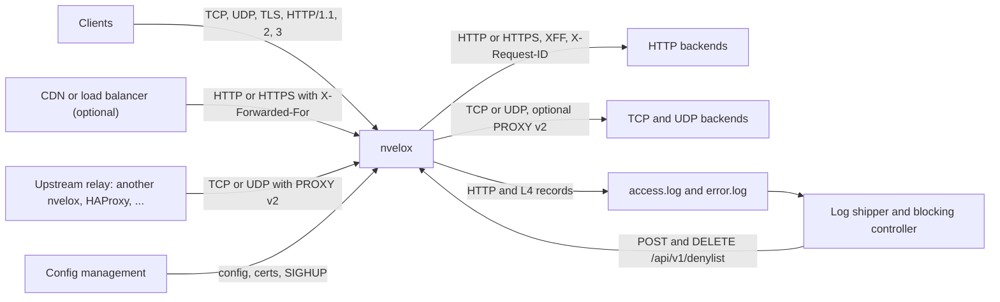
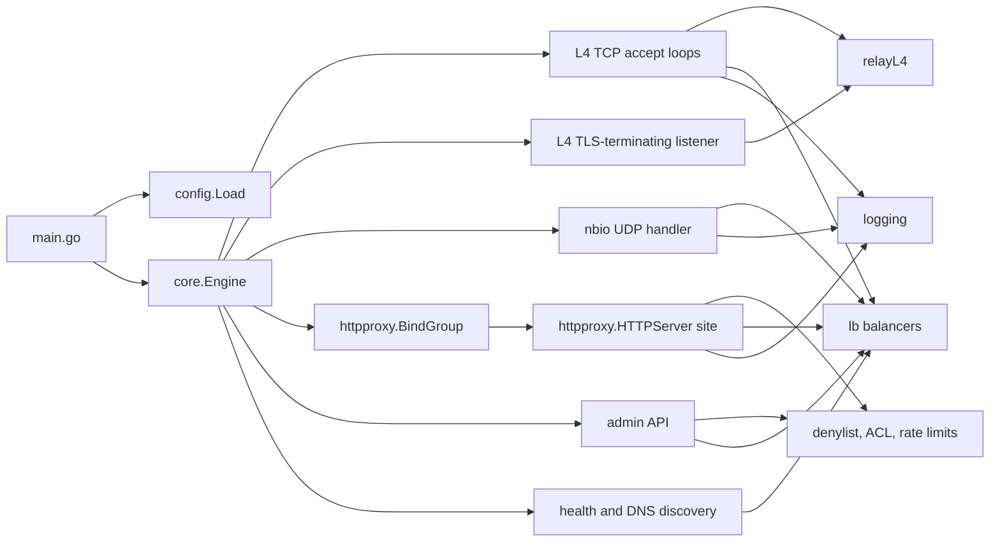
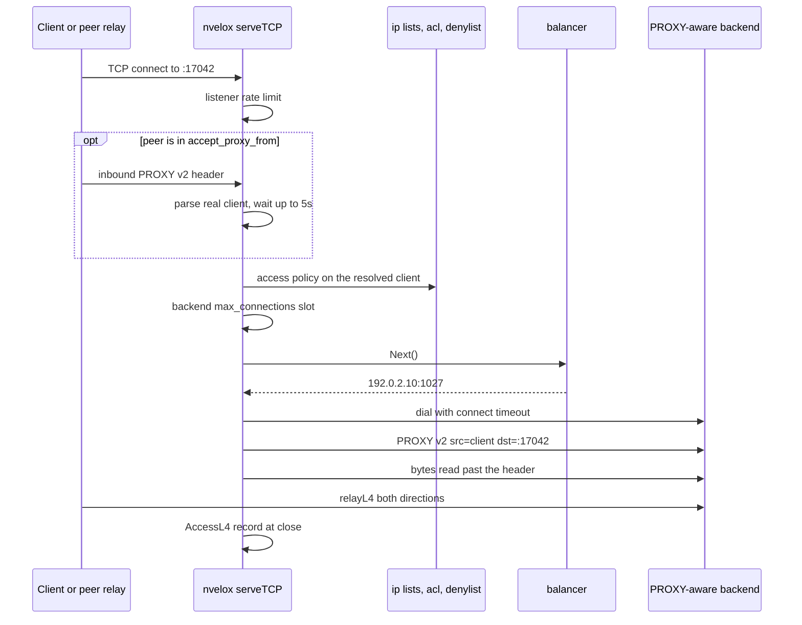
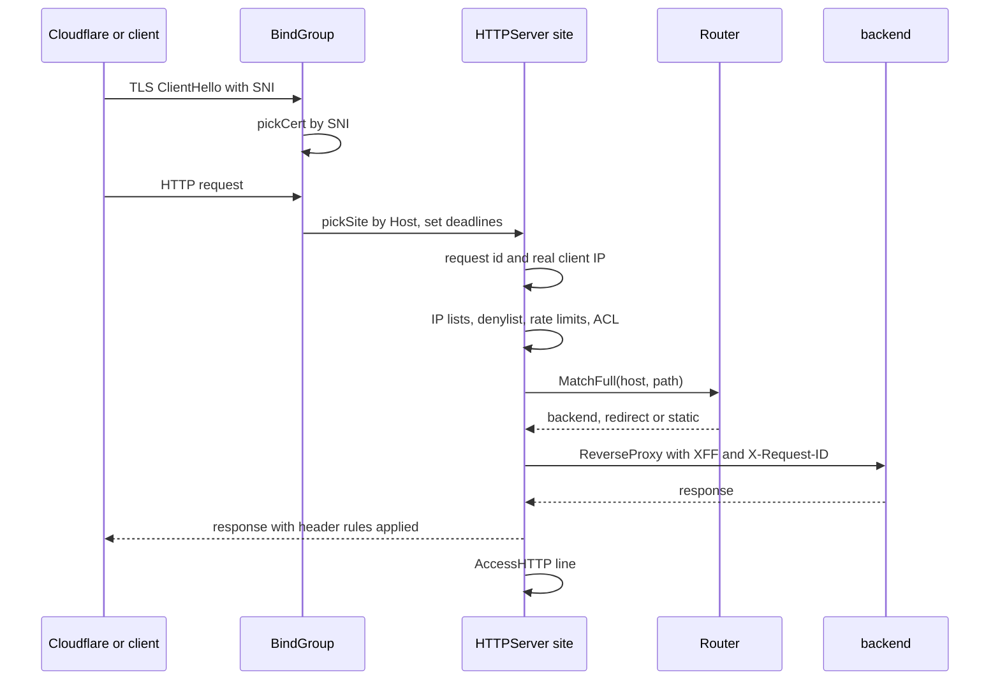
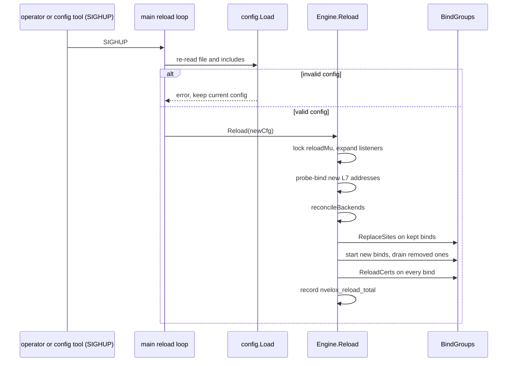
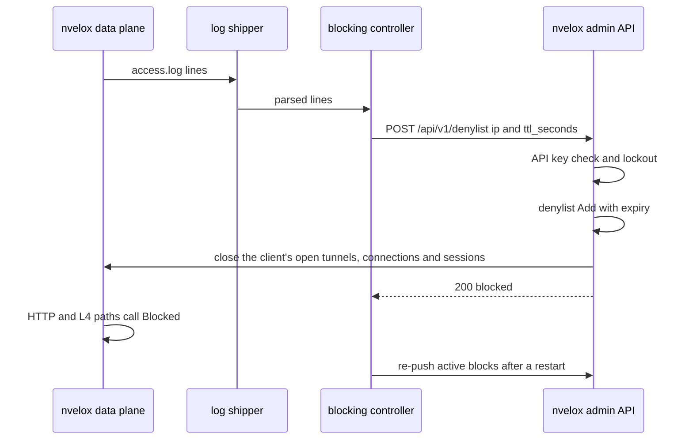

# nvelox architecture

nvelox is a single-binary L4/L7 proxy and load balancer written in Go. It listens on TCP, UDP, HTTP and HTTPS ports (plus optional HTTP/3), forwards each connection or request to a backend pool, and adds PROXY protocol v2, TLS termination, Host/SNI and path routing, ACLs, rate limits and a runtime IP denylist. Typical deployments: an edge proxy that terminates TLS for web sites, an L4 forwarder that hands the client address to its backends with PROXY v2, and chains of nvelox relays. An external controller can push IP blocks into it through the admin API.

## At a glance

| | |
|---|---|
| Role | L4/L7 reverse proxy and load balancer; also the data plane of the nvelox Kubernetes ingress controller |
| Language / runtime | Go 1.26 or newer (`go.mod`), one static binary built with `CGO_ENABLED=0` (`Dockerfile:18`, `.goreleaser.yaml:6-7`) |
| Entrypoint | `main.go:25`: parse `-config`, `config.Load`, start `core.Engine`, handle SIGHUP and SIGUSR1 (`main.go:40-121`, `core/procsignal`) |
| Listeners | Declared in config: `tcp`, `udp`, `http`, `https`, single port or range (`config/config.go:103-195`, `core/engine.go:588-655`). HTTP/3 over QUIC on `https` binds with `http3: true` (`core/httpproxy/bindgroup.go:358-379`). Admin REST API on `admin.bind`, loopback `127.0.0.1:9091` when empty (`core/admin/api.go:121-155`), Prometheus text on `metrics.bind`, loopback `127.0.0.1:9090` when empty (`core/engine.go:152-167`, `core/controlplane.go`) |
| State | In memory only: runtime denylist, balancer and health status, sticky sessions, UDP sessions, rate-limit buckets, response cache. Nothing is persisted |
| Main dependencies | `lesismal/nbio` (UDP event loop), `pires/go-proxyproto`, `quic-go/quic-go`, `yookoala/gofast` (FastCGI), `gopkg.in/yaml.v3` (`go.mod:5-12`). No database, Redis or queue client |

## Context

- **Clients, CDNs and load balancers.** A site behind a CDN or load balancer lists its address ranges in `trusted_proxies`, so the real client comes from `X-Forwarded-For` (`core/httpproxy/server.go`).
- **Relays.** An L4 listener accepts an inbound PROXY v2 header only from peers in `accept_proxy_from` (`core/proxytrust.go`). Over TCP the handshake proves the peer address; over UDP a datagram's source can be forged. A receiver can therefore require signed headers (`accept_proxy_key_file`; a sending nvelox signs with `send_proxy_key_file`) or trust headers only on chosen interfaces (`accept_proxy_interfaces`, UDP); a UDP listener that trusts by address alone starts with a warning.
- **Interface-bound relay trust.** For `accept_proxy_interfaces`, each address of a listed interface gets a UDP socket on the listener's port, bound to the interface (`SO_BINDTODEVICE`); the kernel hands such a socket only datagrams that arrived on that interface. These sockets run in their own UDP engine, and only its sessions may have a relay's header trusted. A datagram that claims a relay's address but arrives on another interface reaches the listener's ordinary socket and is a client like any other. The sockets share the port (`SO_REUSEADDR`), so another program on the machine can bind that UDP port too; on a shared machine the listener should use a port below 1024 or nvelox should run in a container or VM of its own. Interfaces and their addresses are read at start (`core/udpdevice.go`).
- **Signed PROXY headers.** The signature is a TLV of type `0xE4`: version (1 byte, `1`), Unix time in seconds (8 bytes, big-endian) and an HMAC-SHA256 (32 bytes) over the string `nvelox PROXY v2 signature v1`, the timestamp, the transport-protocol byte, the source and destination address (16 bytes each, IPv4 as IPv4-mapped) and ports (2 bytes each, big-endian), and for a datagram the payload after the header. It is valid within 30 s of the receiver's clock; any key of the receiver's file is accepted, and a reload re-reads the file (`proxy/signature.go`, `core/proxytrust.go`). A captured datagram can be replayed unchanged inside that window by someone on the path.
- **PROXY-aware backends.** With `send_proxy_v2: true` the backend receives the client address. The header's destination is the address the client dialed, so one backend socket can serve a whole port range and tell the ports apart (`core/l4tcp.go`, `core/handler.go`).
- **Log consumers.** The access log has one line per HTTP response and per L4 connection or UDP session (see Operating it). A shipper can forward it, and a controller can push blocks back through the admin API (see Key flows).
- **Config management.** Whatever renders the config sends SIGHUP to reload certificates, sites and backends, and restarts nvelox for L4 listener changes (see Config reload).

## Inside

| Package | Responsibility | Key files |
|---|---|---|
| `main` | Flags, config load, logger init, gateway id, engine start, SIGHUP / SIGUSR1 loop | `main.go:40-137` |
| `config` | YAML schema, `include:` merge, defaults, validation | `config/config.go:516-585`, `config/config.go:587-767`, `config/config.go:800-898` |
| `core` (engine) | Builds backends, opens every listener, reload, graceful stop | `core/engine.go:112-357`, `core/engine.go:366-573`, `core/engine.go:712-858` |
| `core` (L4) | TCP accept loops, TLS L4, half-close relay, UDP handler, PROXY trust, UDP session pool, listener rate limiter | `core/l4tcp.go:42-247`, `core/relay.go:16-258`, `core/handler.go:101-501`, `core/proxytrust.go:28-149`, `core/udppool.go:12-138`, `core/ratelimit.go:9-50` |
| `core/httpproxy` | One socket per bind address with SNI cert and Host site selection, then the per-site request pipeline: router, request id, cache, compression, static files, FastCGI | `core/httpproxy/bindgroup.go:20-613`, `core/httpproxy/server.go:387-789`, `core/httpproxy/router.go:86-131`, `core/httpproxy/requestid.go:69-85` |
| `lb` | `roundrobin` (default), `leastconn` and `random` over the healthy set | `lb/lb.go:16-45` |
| `core/health`, `core/discovery` | Active TCP or HTTP probes. DNS re-resolve that drops private IPs unless `allow_private_ips` is set | `core/health/checker.go:36-131`, `core/discovery/dns.go:87-145` |
| `core/denylist` | Process-wide IP and CIDR denylist with TTL | `core/denylist/denylist.go:28-228` |
| `core/admin` | REST API: stats, backends, drain or enable or disable, denylist | `core/admin/api.go:121-517` |
| `core/acl`, `core/middleware` | ACL rules, CIDR lists, per-IP token buckets | `core/acl/acl.go:28-197`, `core/middleware/ipratelimit.go:24-138` |
| `core/circuitbreaker`, `core/sticky`, `core/passivehealth.go`, `core/connlimit.go` | Per-backend breaker, sticky store, passive failure counting, concurrency cap. The breaker, sticky store and passive health are used on the HTTP path only; the concurrency cap (`max_connections`) also bounds L4 TCP connections and UDP sessions | `core/httpproxy/server.go:595-611`, `core/httpproxy/server.go:696-750`, `core/l4tcp.go`, `core/handler.go` |
| `core/logging` | Error log, HTTP and L4 access-log formats, log file modes and reopen | `core/logging/logger.go:95-288`, `core/logging/reopen.go` |
| `core/metrics` | Small Prometheus text registry | `core/metrics/metrics.go:19-197` |
| `core/tlsutil` | TLS version and cipher policy, client-certificate policy (`LoadClientAuth`), SNI wildcard matching | `core/tlsutil/clientauth.go`, `core/tlsutil/sni.go:13-94` |
| `proxy` | PROXY v2 header writer for UDP datagrams | `proxy/proxy_protocol.go:26-105` |

Present but not wired into the engine: `core/sni` (SNI passthrough router), `core/throttle`, `core/scripting` (Lua) and `core/tlsutil/ocsp.go`. No non-test code imports these packages or calls these functions. Their config keys (`sni_routes`, `throttle`, `routes[].scripts`, `tls.ocsp_stapling`) are rejected at load (see Configuration).

### Concurrency model

| Plane | Model | Code |
|---|---|---|
| Plain L4 TCP | One `net.Listen` and one accept goroutine per (expanded) listener. One goroutine per connection, plus one more inside `relayL4` for the second direction. Blocking copies with pooled 16 KiB buffers give real back-pressure. Accept errors back off from 5 ms to 1 s | `core/engine.go:226-245`, `core/l4tcp.go:42-70`, `core/relay.go:45-50`, `core/relay.go:88-101` |
| L4 TLS termination | `tcp` listener with `tls.cert`: `net.Listen`, optionally wrapped by `proxyproto.Listener` (a trusted relay's PROXY header is read before the handshake), under `tls.NewListener`. The handshake, with any `client_auth` check, completes before the backend is dialed. Same accept loop and relay | `core/engine.go` |
| UDP | nbio event loop with `OnOpen`, `OnData` and `OnClose` callbacks. One goroutine per backend session reads replies into a pooled 64 KiB buffer borrowed only while a reply is relayed. Sessions are capped (16,384 per process, 512 per client IP) and kept in a mutex-guarded pool. `OnOpen` runs under nbio's UDP listener mutex, so it never closes a conn synchronously (`closeOnOpen`) | `core/engine.go:254-272`, `core/handler.go`, `core/udpsession.go`, `core/udpread_unix.go` |
| HTTP, HTTPS, HTTP/3 | Go `net/http` server per bind address (a goroutine per connection) and an optional `quic-go` server. Site set and certificates live behind `atomic.Pointer`, so requests never take a lock to find their site | `core/httpproxy/bindgroup.go:20-41`, `core/httpproxy/bindgroup.go:323-400` |
| Background | Per-backend health checker and DNS resolver, sticky, cache and per-IP limiter cleanup loops, denylist sweeper (1 min), UDP pool sweeper (30 s) | `core/engine.go:712-776`, `core/engine.go:147`, `core/udppool.go:106-118` |
| Reload and shutdown | `reloadMu` serialises SIGHUP reloads and is held through `Start` until listeners are up. Shutdown closes listeners, waits for accept loops, closes live L4 conns, then waits up to 30 s for `ActiveConns` | `core/engine.go:112-127`, `core/engine.go:276-340` |

## Key flows

### TCP connection proxied with PROXY v2

- The listener rate limiter runs first. Then the access policy (`ip_denylist`, the dynamic denylist, `ip_allowlist`, source-IP `acl`, in that order) runs on the resolved client: the peer for a direct client; for a trusted relay, the client its PROXY v2 header names (read before anything is dialed), or the relay itself when it sent no header. A trusted relay's own IP is never checked for the clients it relays (`core/l4tcp.go`, `core/l4access.go`). Backend `max_connections` is taken next, one slot per session.
- A server entry without a port gets the listener's port. The dial timeout is the backend's `timeouts.connect`, else the listener's, else 10 s (`core/l4tcp.go:146-172`, `config/config.go:362-371`).
- For a trusted peer, nvelox reads the inbound v2 header off the stream (at most 5 s and 1 MiB) and forwards any payload read past it. A LOCAL, malformed or missing header falls back to the peer address (`core/l4tcp.go:25-29`, `core/l4tcp.go:174-182`, `core/l4tcp.go:221-247`, `core/proxytrust.go:96-128`).
- The outbound header's destination is the address the client dialed, not nvelox's ephemeral source. That lets a backend serve a whole listener port range on one socket and tell the ports apart by the header (`core/l4tcp.go:184-197`).
- `relayL4` forwards everything already read before half-closing the other side (TCP `CloseWrite`, or `close_notify` plus FIN for TLS). Only an RST, a failed write or the idle timeout (default 5 min) aborts both sides (`core/relay.go:16-41`, `core/relay.go:54-62`, `core/relay.go:108-131`, `core/relay.go:188-194`).
- At close one L4 record is written: `ok` or `no_route`. Byte counts are always 0. No record is written for a trusted relay whose real client was never resolved (`core/l4tcp.go:126-143`, `core/logging/logger.go:256-271`).

UDP follows the same rules on nbio. The outbound v2 header is built once per session and prepended to every datagram. Behind a trusted relay every datagram must carry an inbound header naming the same client: it is stripped, the client is admitted (access policy and per-client session cap) on the session's first datagram, and datagrams without a valid header or naming another client are dropped (`core/handler.go`, `core/proxytrust.go:136-149`). TLS-terminating TCP listeners apply the same policy, reading a trusted relay's PROXY header off the raw stream before the handshake, and complete the handshake (and any `client_auth` check) before the backend is dialed (`core/engine.go`).

### HTTP request routed to a backend

- One socket per bind address. `GetCertificate` picks the certificate by SNI: exact name, then wildcard, then the default site's cert. ALPN offers `h2` and `http/1.1`, and TLS defaults to versions 1.2 to 1.3 (`core/httpproxy/bindgroup.go:420-445`, `core/httpproxy/bindgroup.go:578-603`, `core/tlsutil/clientauth.go:105-128`).
- The site is chosen by Host: exact, then leftmost wildcard, then `default_server`, else the first site. Per-site read and write deadlines are set here (default 60 s each) (`core/httpproxy/bindgroup.go:107-131`, `core/httpproxy/bindgroup.go:149-203`, `core/httpproxy/bindgroup.go:237-257`).
- The ACL, the router and the access log see the decoded request path in canonical form: dot segments resolved, duplicate slashes merged (`core/httppath/httppath.go`, `HTTPServer.ServeHTTP`). When canonicalizing changed the path, the backend receives the canonical path; otherwise it receives the path as the client encoded it (an encoded `%2F` inside a segment is kept). The cache key uses the path as sent upstream. Matching is case-sensitive; use `path_regex` with `(?i)` for a case-insensitive backend. A backslash, raw or as `%5C`, is not a path separator: it is passed to the backend unchanged, as nginx and Envoy do by default. nvelox itself never treats it as one: FastCGI script names and try_files targets that contain it are refused (400), and static files are looked up by the literal name. A backend that treats `\` as `/` must normalise paths itself, or ACL rules must also cover the backslash spelling.
- A static route serves files under its root: dotfile paths, scripts (`.php`, `.phtml`, `.phar`) and symlinks out of the root count as missing; a directory serves its first index file, or with `autoindex` an HTML listing of what the route would serve (escaped names, a CSP that runs no script, at most 10,000 entries) (`core/httpproxy/static.go`, `core/httpproxy/autoindex.go`).
- The real client IP is the peer, unless the peer is in `trusted_proxies`. Then nvelox walks every `X-Forwarded-For` line right to left, skipping trusted hops; a hop may carry a port or brackets. A hop that does not parse stops the walk at the nearest trusted hop (or the peer). All IP checks and the access log use this address (`HTTPServer.realClientIP`).
- Gates in order: static `ip_denylist`, dynamic denylist (403), `ip_allowlist`, listener `rate_limit` (applied per request here), `ip_rate_limit` (429), ACL with optional custom status, CONNECT (405), body limit, response cache (`HTTPServer.ServeHTTP`). `0.0.0.0/0` in `ip_allowlist`, `ip_denylist` or an ACL `source_ip` means every client, IPv6 included. A deny rule also matches the path with `;params` removed.
- Routes match first-wins on exact host, path prefix or regex, and can redirect, serve static files or FastCGI, or rewrite. Without a match the listener `backend` is used (`core/httpproxy/router.go:86-131`, `core/httpproxy/server.go:482-585`).
- Proxying (`core/httpproxy/proxy.go`) adds the connection cap, the sticky target, the circuit breaker (asked before each attempt), retries, and `X-Forwarded-For`, `X-Real-IP` and `X-Forwarded-Proto`; from a peer outside `trusted_proxies` the other forwarding headers (`Forwarded`, `X-Forwarded-Host`, `CF-Connecting-IP`, ...) are removed. Headers are set after the client's hop-by-hop headers are removed, so a `Connection:` token cannot strip them. Only failures the backend caused count for passive health and the breaker: not a client that went away (logged 499), a body over `max_body_size` (413), a stalled body (408) or the listener's read timeout (504). `retry.on` is honoured (empty means `connect_failure`); a request is resent only if it never reached the backend with its body untouched, or if it has no body and an idempotent method. WebSocket upgrades go through the same `httputil.ReverseProxy` and transport (so `backend_tls` applies); the connection is hijacked only after a 101 that switches to WebSocket, other `Upgrade` values are stripped, and a failed upgrade closes the client connection. Backend dials time out after 10 s, and the transport keeps up to 256 idle connections per host (`HTTPServer` construction in `core/httpproxy/server.go`).

### Config reload (SIGHUP)

- SIGHUP is caught in `main`. The log files are reopened first, then the config is reloaded; a config that fails to parse or validate is logged and the running config stays. SIGUSR1 only reopens the log files, for logrotate (`main.go:87-121`, `core/logging/reopen.go`).
- The reload is all-or-nothing for new L7 bind addresses: each is probe-bound before anything changes (`core/engine.go:366-401`, `core/engine.go:476-501`).
- Kept backends keep their balancer (least-conn counts), sticky store and breaker, and only swap the server list. Removed backends have their goroutines stopped (`core/engine.go:784-858`).
- Kept bind groups swap their site set atomically, so in-flight requests finish on the old site. Removed groups drain for up to 10 s in the background (`core/engine.go:505-562`, `core/httpproxy/bindgroup.go:276-317`).
- Certificates are re-read for every site. A file that fails to load keeps the previous cert (`core/httpproxy/bindgroup.go:494-551`). A certificate renewal therefore needs only a SIGHUP.
- Not reloaded, so they need a restart: L4 TCP, TLS and UDP listeners and their per-listener settings, listener `rate_limit`, logging settings (the files themselves are reopened), admin and metrics (`core/engine.go:128-135`, `core/engine.go:226-273`, `main.go:59-65`).

The nvelox Kubernetes ingress controller (a separate project) writes its rendered fragment atomically, then sends SIGHUP to the nvelox process it finds by pid file or `/proc` (`nvelox-ingress-controller/internal/reloader/reloader.go:54-127`).

### Denylist update from an external controller

- The admin API requires `api_key` (load error without it, `config/controlplane.go`). Every request passes, in order: loopback-only peers when bound to loopback, a `Host` header naming the bind address (DNS rebinding), Go's cross-origin protection (`Sec-Fetch-Site` / `Origin`), a constant-time `X-API-Key` comparison, then `Content-Type: application/json` on state-changing requests. A valid key is always served; 10 failures from one IP in 10 min make that IP's further failures return 429 for 15 min, and the failure table is capped at 4096 IPs and pruned (`core/admin/api.go:30-48`, `core/admin/api.go:162-357`).
- `POST` takes `{ip, ttl_seconds}` (TTL 0 or less never expires; ranges wider than an IPv4 /8 or IPv6 /16, including `::ffff:0:0/96`, are refused), `DELETE` takes `?cidr=` or `{ip}`, and `GET` lists live entries (`core/admin/api.go:446-507`, `core/denylist/denylist.go:30-58`).
- Single hosts are stored in a map, ranges in a scanned list. Expired entries stop matching at once, and a sweeper removes them every minute (`core/denylist/denylist.go:76-131`, `core/engine.go:142-148`).
- The HTTP path checks every request against the resolved client IP (`HTTPServer.clientStatus` in `core/httpproxy/server.go`). L4 checks every TCP / TLS connection and UDP session on the resolved client: at accept time for a direct client, once its PROXY v2 header is parsed for a client behind a trusted relay (`core/l4tcp.go`, `core/engine.go`, `core/handler.go`).
- An add also closes what the blocked client has open: its WebSocket tunnels (the client the access rules checked), its L4 TCP and TLS connections and its UDP sessions. Behind a trusted relay that is the client the relay's PROXY header named; a TCP relay that sent no header is itself the client, as in the access check (`core/denyclose.go`).
- Entries live only in memory, so a controller should re-push its active blocks when nvelox restarts (for example on a timer). Each nvelox instance has its own denylist; a controller blocking an IP everywhere calls every instance.

## Data and state

nvelox owns no database tables, Redis keys or queues. Everything below is per process and lost on restart.

| State | Where | Lifetime and invalidation |
|---|---|---|
| Runtime denylist | `denylist.Default`, shared by all sites (`core/denylist/denylist.go:28`) | Survives SIGHUP, lost on restart. TTL per entry, swept every minute |
| Balancer server list and health | `lb` balancers per backend (`lb/lb.go`) | Kept across reload. `UpdateServers` (reload or DNS change) marks every server healthy again. A passive-health ejection (`max_fails`) lasts 30 s, then the server takes traffic again; it never re-enables a server an active check or the admin API marked down (`core/passivehealth.go`, `Balancer.Eject`) |
| Least-conn counts | `LeastConn.conns` (`lb/lb.go:245-253`) | Kept across reload, lost on restart |
| Sticky sessions | `sticky.Store` per backend for `header` (SHA-256 of the value, values over 256 bytes ignored) and `ip_hash`, TTL default 1 h, max 100,000 (`core/engine.go:727-736`, `core/sticky/sticky.go`). `cookie` mode keeps no state: the cookie carries the server's token, is checked against the pool's servers, and is issued (HttpOnly, SameSite=Lax, Secure over TLS) when absent | Kept across reload |
| UDP sessions | `UDPPool`, key client, local port and backend, 60 s idle TTL (`core/handler.go:405`, `core/engine.go:139`) | Evicted every 30 s |
| Rate-limit buckets | Listener buckets in `Engine.RateLimiters` (`core/engine.go:128-135`). Per-IP buckets per site, max 100,000 IPs (`core/middleware/ipratelimit.go:52`) | Listener buckets live for the process. Per-IP buckets are rebuilt with each site on reload |
| Response cache | Per site, key method, host, requested path as sent upstream, query and gzip-or-identity, keys over 4 KiB not cached (`core/httpproxy/cache.go`) | TTL default 5 min, emptied on reload because sites are rebuilt (`core/engine.go:663-705`). Only a 200 received in full is stored; entries are capped at 8 MiB (or `max_size`), and `max_size` unset means 64 MiB. Skipped for `Authorization`, `Cookie`, `Range` / `If-*` requests, `no-store`, `Set-Cookie`, event streams and unknown `Vary`. Hits go through compression like fresh responses (`core/httpproxy/cache.go`, `HTTPServer.serveCached`) |
| TLS certificates | `tlsState` per bind group (`core/httpproxy/bindgroup.go:58-61`) | Re-read on every SIGHUP |

Files: the main config and its `include:` glob, which must stay under the main file's directory (`config/config.go:949-991`). The release image uses `/etc/nvelox/nvelox.conf` and `/etc/nvelox/config.d/` (`Dockerfile.goreleaser`). Also the TLS cert and key files, and the access and error logs.

## Configuration

Command line: `-config` (default `nvelox.yaml`) and `-version` (`main.go:41-51`). There are no environment variables. Config is YAML and must say `version: "2"` (`config/config.go:588-590`). Included files contribute only `listeners` and `backends` (`config/config.go:535-556`).

| Key | Meaning and default |
|---|---|
| `server.gateway_id` | Written as `gw=` on HTTP access lines. Default is the hostname (`core/logging/logger.go:78-85`). |
| `logging.level`, `access_log`, `error_log` | Level default `info` (`config/config.go:559-561`). An empty path means stdout for access and stderr for errors (`core/logging/logger.go:130-193`). Files are created `0640` in `0750` directories and an existing file is tightened to `0640`; reopened on SIGHUP and SIGUSR1 (`core/logging/reopen.go`) |
| `admin.enabled`, `bind`, `api_key` | REST API. The key is required when enabled (load error, `config/controlplane.go`); an empty bind means `127.0.0.1:9091` (`core/admin/api.go:27`) |
| `metrics.enabled`, `bind`, `path` | Prometheus endpoint, path default `/metrics`, an empty bind means `127.0.0.1:9090` (`core/engine.go:152-167`, `core/controlplane.go`). |
| `listeners[].protocol`, `bind` | `tcp` (default), `udp`, `http` or `https`. A bind like `:17000-17100` expands to one listener per port named `<name>-<port>` (`config/config.go:563-566`, `core/engine.go:637-645`) |
| `listeners[].backend` | Pool name. `default_backend` is the deprecated alias, and setting both is an error (`config/config.go:567-577`) |
| `server_names`, `default_server` | Multi-site per port. Rules: one protocol per socket, at most one default, every non-default site has names, names are unique (`config/config.go`) |
| `tls` | `cert`, `key`, `min_version` (default 1.2), `max_version` (default 1.3), `cipher_suites`, `client_auth` (`require`, `request` or `none`) with `client_ca`. Files must exist at load; the client CA must parse. On a shared HTTPS bind the client-certificate policy is per site, chosen by SNI, and a request whose Host names a `client_auth` site over a connection whose SNI chose another site is answered 421 (`config/config.go`, `core/tlsutil/clientauth.go`, `core/httpproxy/bindgroup.go`) |
| `trusted_proxies` | L7 trust for `X-Forwarded-For` and `X-Real-IP`. Empty means the headers are overwritten with the peer (`core/httpproxy/server.go:856-904`) |
| `accept_proxy_from` | L4 trust for an inbound PROXY v2 header. Empty means trust nobody. CIDRs are validated at load (`config/config.go:663-670`) |
| `rate_limit`, `ip_rate_limit` | Token buckets: per listener (connections on L4, requests on L7) and per client IP on L7 (`core/engine.go:128-135`, `core/httpproxy/server.go:439-452`) |
| `ip_allowlist`, `ip_denylist`, `acl`, `max_body_size` | Static controls. The IP lists and ACL apply to HTTP requests and to TCP, TLS and UDP sessions; on tcp/udp listeners an ACL rule may match `source_ip` only. Entries must be valid IPs/CIDRs, ACL actions are `allow` or `deny` with `status` 100-599, and `path_regex` must compile (`config/config.go`) |
| `timeouts` | `connect` (L4 dial, default 10 s). `read_header`, `read`, `write`, `idle` on HTTP (10 s, 60 s, 60 s, 120 s). `idle` on L4 TCP (5 min) (`core/httpproxy/bindgroup.go:137-142`, `core/relay.go:54-62`) |
| `request_id.enabled`, `trust_inbound` | Mint or keep `X-Request-ID`. Inbound ids must be hex or dash and at most 128 chars (`core/httpproxy/requestid.go:42-85`) |
| `routes[]` | `match` on `host`, `path_prefix` or `path_regex`, then `backend`, `redirect`, `rewrite`, `headers`, `static`, `try_files`, `fastcgi`, `expires` (`config/config.go:278-331`) |
| `backends[].balance`, `servers` | `roundrobin` (default), `leastconn` or `random`. At least one server (`config/config.go:593-627`) |
| `backends[].send_proxy_v2` | Prepend PROXY v2 on L4 TCP, L4 TLS and UDP. Ignored by the HTTP path (`core/l4tcp.go:186-197`, `core/engine.go:1029-1036`) |
| `backends[].backend_tls` | HTTPS to backends with `ca_cert`, mTLS client cert, or `insecure`, from HTTP/HTTPS listeners only: a tcp/udp listener on such a backend is rejected at load. A CA or key pair that cannot be loaded fails the load, startup and reload; a request to a backend whose TLS config is missing gets 502, never plaintext (`core/httpproxy/server.go`, `core/engine.go`) |
| `backends[].retry`, `health_check`, `circuit_breaker`, `sticky_session`, `max_connections`, `resolve_interval`, `allow_private_ips` | See Inside. Breaker timeout default 30 s, health probe timeout default 1 s (`core/engine.go:738-750`, `core/health/checker.go:83-87`) |

Rejected at load because nothing implements them: `sni_routes`, `throttle`, `tls.ocsp_stapling: true` and `routes[].scripts`. Accepted with a startup WARNING on stderr: `pid_file` and `workers` (no pid file is written, one process runs). `server.user` and `group` are applied once every socket is bound and the log files are handed over: a root process switches (`core/privdrop`) or exits if it cannot; a process that is not root warns and runs as it is. Nothing is served before that: the sockets are bound, but HTTP, TCP, UDP, the admin API and metrics answer only after the switch (`Engine.HoldServing`, `core/servegate`); connections wait in the kernel's accept queue meanwhile. The log files are handed over through their open descriptors, and as root nvelox opens a log path without following a symbolic link (outside `/dev` and `/proc`), so a log directory writable by that user cannot point root at another file (`core/logging/reopen.go`). Everything else nvelox reads at start (the config, certificates, keys, CA and PROXY key files, error pages) is read as root and must not be writable by that user. Accepted with no effect: `tracing`, `zero_copy` (`config/config.go:107-110`), `tls.auto_cert`, `grpc` and backend `timeouts.read`. tcp and udp listeners must name a `backend`.

## Operating it

**Build, release and deploy.** CI runs `go build` and `go test` on pushes and PRs to `main` (`.github/workflows/test.yml:1-33`). A `v*` tag runs GoReleaser: linux amd64 and arm64 binaries with `main.Version` stamped, plus multi-arch images `ghcr.io/nvelox/nvelox:<tag>`, `<major>.<minor>` and `latest` (`.github/workflows/release.yml:1-60`, `.goreleaser.yaml:1-69`, `Dockerfile.goreleaser:1-10`). A `go build` without `-ldflags` reports `dev` for `-version` (`main.go:22`).

**Health and metrics.** There is no health or readiness endpoint. `GET /api/v1/stats` on the admin API returns uptime and the backend count (`core/admin/api.go:200-207`). The metrics endpoint exports only `nvelox_reload_total{result}`, `nvelox_reload_duration_seconds` (`core/engine.go:426-432`) and `nvelox_udp_dropped_total{reason}` (UDP sessions and datagrams refused by the session caps or the trusted-relay header rule, `core/udpsession.go`). No traffic metrics are recorded.

**Logs.** The access log has no timestamp and two line shapes (`core/logging/logger.go:259-315`):
- HTTP: `<client> - <host> "<method> <path> <proto>" <status> <bytes> <ms>ms -> <backend> "<UA>" fetch_site=<Sec-Fetch-Site> fetch_dest=<Sec-Fetch-Dest> scheme=<https|http> rid=<id> gw=<gw> site=<listener>`. `fetch_site` and `fetch_dest` are `-` when the header is absent; `scheme` is `https` when the request arrived over TLS (HTTP/3 included)
- L4: `<client> - l4 <proto>/<port> <ok|no_route|ratelimited|denylisted> 0 0 <ms>ms`

Every HTTP response gets exactly one line, written when the request ends (for a WebSocket: when the tunnel closes, status 101, bytes sent through the tunnel), with the status the client was sent; `499` means the client went away before an answer. `<path>` is the decoded canonical path re-escaped (one spelling per path, whatever the client's encoding), `<backend>` is `-` when no backend was tried. All fields are sanitised against CRLF, `"` and `\` in the path and User-Agent are written as `\x22` and `\x5C`, and the User-Agent is cut to 512 bytes (`core/logging/logger.go`). Operational messages go to the error log. Both default to `/var/log/nvelox/` in the release image (`Dockerfile.goreleaser`).

**Behaviour to know about**
- L7 backend dials time out after a fixed 10 s; backend `timeouts.connect` is used only by L4 dials (`core/httpproxy/server.go`, `core/l4tcp.go:160-165`).
- The TLS-terminating L4 path's PROXY v2 destination is nvelox's own source address, not the dialed port (`core/engine.go`).
- A WebSocket tunnel is closed after the site's `timeouts.idle` (120 s when unset) without a byte either way, and when its listener stops (`core/httpproxy/tunnel.go`).
- A SIGHUP reload checks every open tunnel against the new configuration the way its upgrade request would be checked. The site its `Host` reaches must accept the connection's client certificate, which must still verify against the site's current client CAs (a reload may replace them, and the certificate may have expired). The client checks (`ip_denylist`, the dynamic denylist, `ip_allowlist`) and the ACL must pass. The request must match the same route to the same backend, which must still list the tunnel's server, with the same `backend_tls` setting. A tunnel that passes keeps running with the site's current idle timeout; the others are closed, and so is a tunnel whose request `try_files` moved. An upgrade still in flight during the reload is checked when its tunnel starts. Rate limits are not applied again: they meter new requests (`BindGroup.recheckTunnel` in `core/httpproxy/bindgroup.go`, `HTTPServer.tunnelRefusal` in `core/httpproxy/server.go`).
- Active health checks probe the server list the backend had when it was created. Reload does not update the checker, and a server-list change marks every server healthy again (`lb/lb.go:118-128`, `core/health/checker.go:70-80`, `core/engine.go:765-774`).

**Timeouts and limits**

| Limit | Value | Code |
|---|---|---|
| L4 dial | 10 s default | `config/config.go:362-371` |
| L4 TCP idle (no bytes either way) | 5 min default, `0` disables | `core/relay.go:54-62` |
| Inbound PROXY header wait, trusted peer | 5 s on plain TCP, 10 s on TLS L4 | `core/l4tcp.go:25`, `core/engine.go:962-966` |
| UDP sessions | 16,384 per process, 512 per client IP; a session ends 10 s after it opened if the backend never answered, else 60 s after the backend's last reply; 1 MiB pre-connect buffer. Refusals count in `nvelox_udp_dropped_total{reason}` | `core/udpsession.go`, `core/handler.go` |
| L4 TLS handshake | 10 s, completed before the backend is dialed; trusted PROXY header wait 10 s | `core/engine.go` |
| HTTP header, read, write, idle | 10 s, 60 s, 60 s, 120 s | `core/httpproxy/bindgroup.go:137-142` |
| Backend pool | 1024 idle conns, 256 per host, 90 s idle, 10 s TLS handshake | `core/httpproxy/server.go:197-206` |
| L7 backend dial (WebSocket included) | 10 s | `core/httpproxy/server.go` (`backendDialTimeout`) |
| WebSocket tunnel idle | site `timeouts.idle`, else 120 s | `core/httpproxy/tunnel.go` |
| Admin API | 5 s headers, 10 s read and write, 30 s idle, 8 KiB headers, 4 KiB body | `core/admin/api.go:145-153`, `core/admin/api.go:48` |
| Metrics endpoint | 5 s headers, 10 s read and write, 30 s idle, 8 KiB headers | `core/controlplane.go` |
| Shutdown | admin 5 s, each bind group 10 s, L4 drain 30 s | `core/engine.go:286-340` |

**Failure modes**

| Situation | Behaviour |
|---|---|
| Invalid config on SIGHUP | Rejected, old config keeps serving (`main.go:95-102`) |
| Missing or broken cert at start | Load fails and the process exits (`config/config.go:673-684`, `core/httpproxy/bindgroup.go:450-487`) |
| Cert fails to load on reload | That site keeps its previous cert (`core/httpproxy/bindgroup.go:518-527`) |
| HTTP port already taken at start | Error logged in the serve goroutine, the process keeps running without that port (`core/httpproxy/bindgroup.go:381-397`) |
| Backend node down, no health checks | L4: dial fails and the client is closed with `no_route`. L7: 502, or a retry if `retry.attempts` is above 1 and `retry.on` covers it (`core/l4tcp.go:166-172`, `core/httpproxy/proxy.go`) |
| All servers unhealthy | L4 closes the connection, L7 returns 503 (`lb/lb.go:76-86`, `core/httpproxy/server.go:666-675`) |
| nvelox restart | Denylist empty (fails open) until the controller re-pushes its blocks. In-flight L4 sessions are closed (`core/engine.go:308-311`) |
| Trusted peer sends no or bad PROXY header | TCP: falls back to the peer address, which is then the client the access policy checks (`core/l4tcp.go`). UDP: the datagram is dropped (`core/handler.go`) |
| Backend has no healthy server (UDP) | The new session is refused through `closeOnOpen`; the UDP poller keeps serving (`core/handler.go`) |

## Code map

| To change | Start at |
|---|---|
| Config schema, defaults, validation | `config/config.go:16-28`, `config/config.go:516-585`, `config/config.go:587-767` |
| Startup order and graceful shutdown | `core/engine.go:112-357` |
| What SIGHUP reloads | `core/engine.go:366-421`, `core/engine.go:448-571` |
| Backend wiring (balancer, health, sticky, breaker, DNS) | `core/engine.go:712-776` |
| Plain L4 TCP path and PROXY v2 | `core/l4tcp.go:99-213` |
| Half-close relay semantics | `core/relay.go:88-194` |
| UDP path | `core/handler.go:101-501` |
| L4 TLS termination | `core/engine.go:931-1047` |
| Inbound PROXY trust | `core/proxytrust.go:28-149` |
| HTTP request pipeline and gate order | `core/httpproxy/server.go:387-789` |
| Multi-site per port, SNI certs, cert reload | `core/httpproxy/bindgroup.go:107-131`, `core/httpproxy/bindgroup.go:420-551` |
| Route matching and rewrites | `core/httpproxy/router.go:45-151` |
| Real client IP and forwarded headers | `core/httpproxy/server.go:856-961` |
| X-Request-ID policy | `core/httpproxy/requestid.go:69-85` |
| Access-log format (log parsers depend on it) | `core/logging/logger.go:225-271` |
| Denylist store and admin API | `core/denylist/denylist.go:30-260`, `core/admin/api.go:121-517` |
| Load-balancing algorithms | `lb/lb.go:35-383` |
| Metrics | `core/metrics/metrics.go:94-197`, `core/engine.go:426-432` |
| Release pipeline | `.goreleaser.yaml:1-69`, `.github/workflows/release.yml:1-60` |

_Generated from nvelox source at commit cd99d77 on 2026-10-09. Every statement cites the code it comes from; if the code changes, this page should be re-checked._
