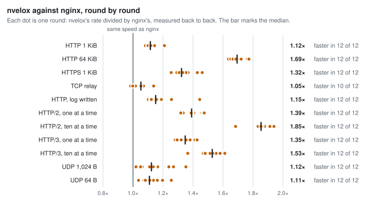
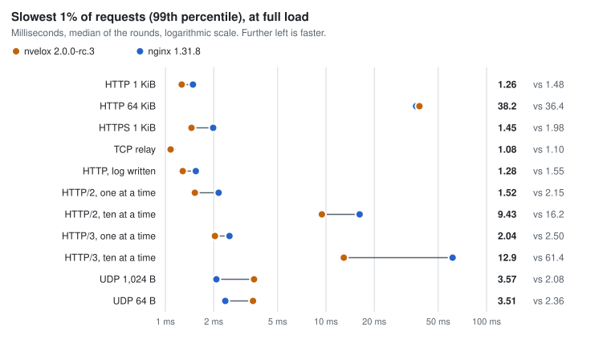
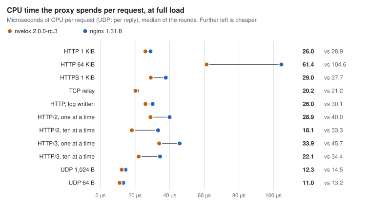
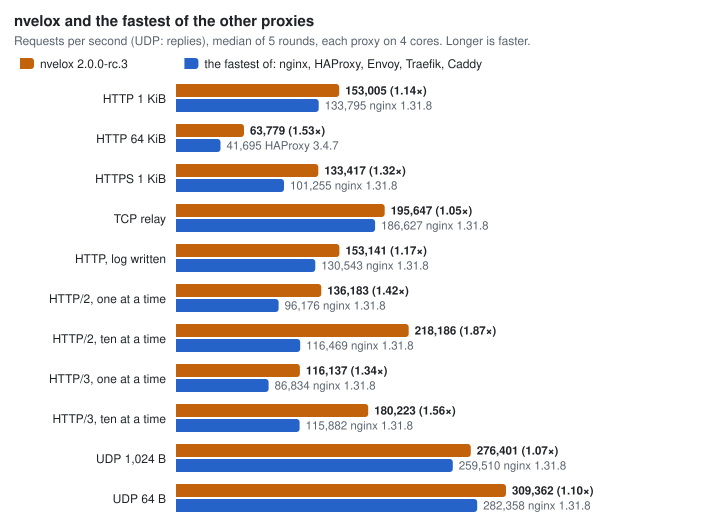
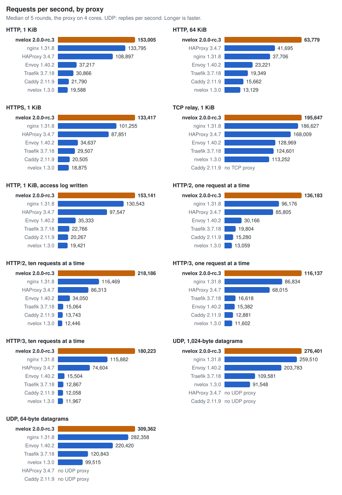
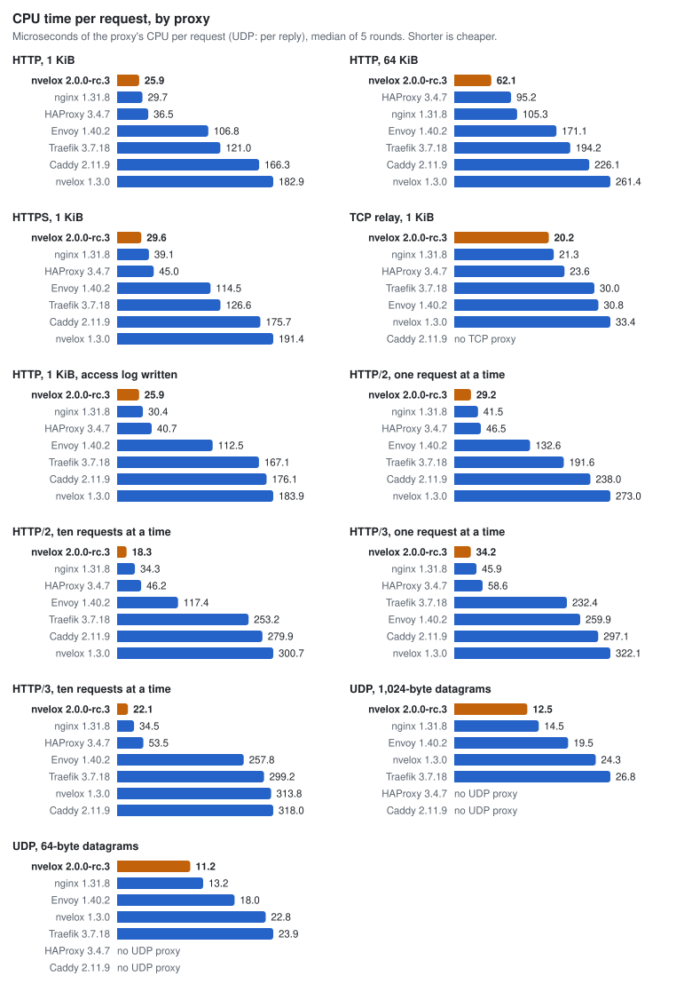
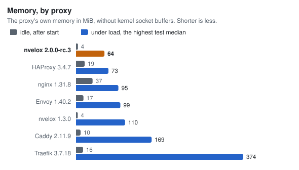
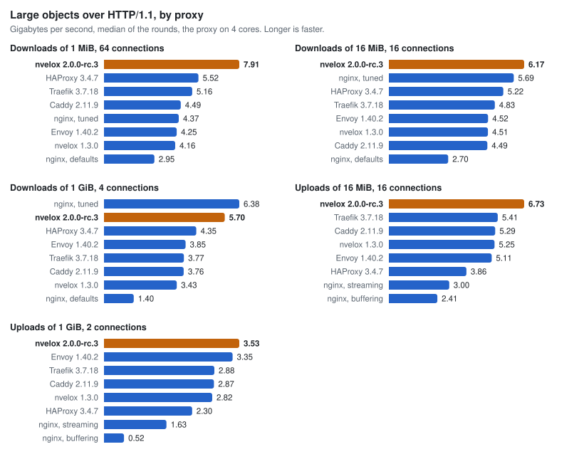
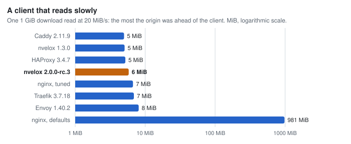

# Performance

## How nvelox moves traffic

On Linux, nvelox runs one event loop per CPU it may use (`GOMAXPROCS`). Each loop is a goroutine that drives its own epoll instance over non-blocking sockets. HTTP/1.1 (with or without TLS), HTTP/2, HTTP/3, and plain TCP and UDP listeners run on these loops:
- a strict parser handles requests without allocating;
- each loop keeps its own keep-alive connections to the backends, shared by the three HTTP versions;
- HTTP/2 output is encrypted and written once per pass of a loop, and HTTP/3 and UDP datagrams are read and sent in batches;
- HTTP/3 runs on nvelox's own QUIC transport, one UDP socket per loop;
- the access log is written once per loop iteration.

WebSocket and the site features that need Go's `net/http` (response cache, compression, client certificates, static files, FastCGI and a few more) run through `net/http`, as on other platforms: an HTTP/1.1 connection is handed over, an HTTP/2 or HTTP/3 request is passed to a handler while its connection stays on its loop. [ARCHITECTURE.md](ARCHITECTURE.md#http11-on-the-event-loops-linux) lists exactly what runs where.

## Benchmark

nvelox 2.0.0-rc.3 against nginx 1.31.8, HAProxy 3.4.7, Envoy 1.40.2, Traefik 3.7.18, Caddy 2.11.9 and nvelox 1.3.0 as reverse proxies in front of the same origin, each on the same 4 CPU cores, one proxy under load at a time. Measured on 2026-11-18 with the kit in [`bench/`](../bench/); every table and chart below is made from the raw results in [`bench/results/v2.0.0-rc.3/`](../bench/results/v2.0.0-rc.3/), which also holds the full report of the run.

### Summary

- **Requests against nginx:** nvelox was the faster of the two in all 11 tests and in 130 of the 132 rounds. The margin is 1.05x to 1.85x: HTTP/1.1 1.12x with 1 KiB responses and 1.69x with 64 KiB, HTTPS 1.32x, TCP 1.05x, HTTP/2 1.39x and 1.85x, HTTP/3 1.35x and 1.53x, UDP 1.12x and 1.11x.
- **Requests against every proxy:** of the 7 proxies measured, nvelox served the most requests in all 11 tests.
- **Latency at full load:** nvelox's median latency was lower than nginx's in all 11 tests, its 99th percentile in 8 of them.
- **CPU:** nvelox used 5% to 46% less CPU per request than nginx, and the least of all proxies in all 11 tests.
- **Memory:** nvelox used 4 MiB when idle (nginx: 37 MiB) and at most 64 MiB under load (nginx: 95 MiB); the other proxies between 73 and 374 MiB under load.
- **Large objects through nvelox:** downloads of 1 MiB 7.91 GB/s (next: HAProxy 3.4.7, 5.52); 16 MiB 6.17 GB/s (next: nginx tuned for large files, 5.69); 1 GiB 5.70 GB/s (faster: nginx tuned for large files, 6.38); uploads of 16 MiB 6.73 GB/s (next: Traefik 3.7.18, 5.41); 1 GiB 3.53 GB/s (next: Envoy 1.40.2, 3.35). In parentheses, the fastest other proxy or nginx setup.
- **A slow client:** while one client read a 1 GiB file at 20 MiB/s, nvelox let the origin get at most 6 MiB ahead of it and used 3.7 MiB of memory; nginx with its defaults held 981 MiB.

### Setting

| Setting | Value |
|---|---|
| Machine | 20 vCPU VM, Intel Xeon Gold 6242R 3.1 GHz (VMware), 15.6 GiB RAM, Linux 6.8 |
| Proxy | 4 vCPUs (cpuset). nginx `worker_processes`, HAProxy `nbthread` and Envoy `--concurrency` are set to that; the Go proxies take the count from the CPUs they may run on |
| Origin | nginx 1.31.8 on 4 other vCPUs, serving static files: 1 KiB and 64 KiB, and 1 MiB, 16 MiB and 1 GiB held in memory for the large-object tests. For UDP, an echo server; for uploads, a sink that reads every body to its end |
| Load | On the remaining 8 vCPUs, 8 threads. wrk with 128 keep-alive connections for HTTP/1.1, HTTPS and TCP; h2load (nghttp2 with ngtcp2) with 128 connections for HTTP/2 and HTTP/3; for UDP, 128 flows that each keep one datagram in flight; for large objects, a Go client with 2 to 64 connections |
| Runs | 3 s warm-up, then 10 s measured. 12 rounds of nvelox and nginx, measured back to back; the other proxies in the first 5 rounds. Large objects: 12 s measured, 3 rounds, every proxy in each. The tables show medians |
| Packaging | Every process in its own Docker container with host networking, everything over 127.0.0.1. nvelox is the release's static binary in `ubuntu:24.04`, running as an unprivileged user |
| TLS | TLS 1.3 with AES-128-GCM and an ECDSA P-256 certificate, for every proxy |
| Versions | nvelox 2.0.0-rc.3, nginx 1.31.8, HAProxy 3.4.7, Envoy 1.40.2, Traefik 3.7.18, Caddy 2.11.9, nvelox 1.3.0 |

The tests:

- **HTTP 1 KiB, HTTP 64 KiB:** a GET of a static file through the proxy.
- **HTTPS 1 KiB:** the same over TLS, with keep-alive.
- **TCP relay:** HTTP 1 KiB through a TCP (layer 4) listener. Caddy's stock image has no TCP proxy.
- **HTTP 1 KiB, access log written:** every proxy formats and writes one access-log line per request, to a sink that discards it. nvelox writes its access log in every HTTP test; the other proxies only in this one.
- **HTTP/2, HTTP/3:** a GET of the 1 KiB file over TLS, with one request at a time on each connection, and with ten.
- **UDP:** datagrams of 1,024 and of 64 bytes to an origin that sends each one back; replies per second. HAProxy and Caddy's stock image have no UDP proxy.
- **Large objects (plain HTTP/1.1):** downloads of 1 MiB (64 connections), 16 MiB (16) and 1 GiB (4); uploads of 16 MiB (16 connections) and 1 GiB (2); and one 1 GiB download by a client that reads 20 MiB/s.

Every proxy keeps a keep-alive pool to the origin and speaks HTTP/1.1 to it. Each runs its stable release from its official image with what a careful operator would set for this job; [`bench/README.md`](../bench/README.md#the-proxies-configuration) lists what differs from each proxy's defaults, and [`bench/conf/`](../bench/conf/) has the files.

<!-- bench:begin -->
<!-- made by bench/report.py from ../bench/results/v2.0.0-rc.3: do not edit by hand -->

### nvelox 2.0.0-rc.3 against nginx 1.31.8

Both are measured back to back in each of the 12 rounds, so every round gives one ratio. *Ratio* is the median of those ratios; *faster in* counts the rounds in which nvelox was the faster of the two. nvelox was the faster in 130 of the 132 paired measurements.

| Test | nvelox 2.0.0-rc.3 | nginx 1.31.8 | Ratio | Faster in | 99th percentile, ms | CPU per request, µs |
|---|---:|---:|---:|---:|---:|---:|
| HTTP, 1 KiB | 152,541 | 137,351 | 1.12× | 12 of 12 | 1.26 vs 1.48 | 26.0 vs 28.9 |
| HTTP, 64 KiB | 64,618 | 37,977 | 1.69× | 12 of 12 | 38.20 vs 36.39 | 61.4 vs 104.6 |
| HTTPS, 1 KiB | 136,272 | 105,101 | 1.32× | 12 of 12 | 1.45 vs 1.98 | 29.0 vs 37.7 |
| TCP relay, 1 KiB | 195,829 | 187,289 | 1.05× | 10 of 12 | 1.08 vs 1.10 | 20.2 vs 21.2 |
| HTTP, 1 KiB, access log written | 152,337 | 131,836 | 1.15× | 12 of 12 | 1.28 vs 1.55 | 26.0 vs 30.1 |
| HTTP/2, one request at a time | 137,823 | 99,955 | 1.39× | 12 of 12 | 1.52 vs 2.15 | 28.9 vs 40.0 |
| HTTP/2, ten requests at a time | 220,503 | 119,960 | 1.85× | 12 of 12 | 9.43 vs 16.20 | 18.1 vs 33.3 |
| HTTP/3, one request at a time | 117,297 | 87,243 | 1.35× | 12 of 12 | 2.04 vs 2.50 | 33.9 vs 45.7 |
| HTTP/3, ten requests at a time | 180,615 | 116,114 | 1.53× | 12 of 12 | 12.90 vs 61.42 | 22.1 vs 34.4 |
| UDP, 1,024-byte datagrams | 280,727 | 260,011 | 1.12× | 12 of 12 | 3.57 vs 2.08 | 12.3 vs 14.5 |
| UDP, 64-byte datagrams | 308,865 | 282,793 | 1.11× | 12 of 12 | 3.51 vs 2.36 | 11.0 vs 13.2 |

Rates are requests per second (UDP: replies per second), latency and CPU are nvelox vs nginx; all are medians of the rounds.

<picture><source media="(prefers-color-scheme: dark)" srcset="../bench/results/v2.0.0-rc.3/charts/ratio-dark.svg"></picture>

<picture><source media="(prefers-color-scheme: dark)" srcset="../bench/results/v2.0.0-rc.3/charts/latency-dark.svg"></picture>

<picture><source media="(prefers-color-scheme: dark)" srcset="../bench/results/v2.0.0-rc.3/charts/cpu-dark.svg"></picture>

### All proxies

Medians of the 5 rounds in which every proxy was measured (the first rounds of the same run). The best of each column is bold.

<picture><source media="(prefers-color-scheme: dark)" srcset="../bench/results/v2.0.0-rc.3/charts/lead-dark.svg"></picture>

<picture><source media="(prefers-color-scheme: dark)" srcset="../bench/results/v2.0.0-rc.3/charts/requests-dark.svg"></picture>

HTTP/1.1, HTTPS and TCP. Requests per second, median of 5 rounds:

| Proxy | HTTP 1 KiB | HTTP 64 KiB | HTTPS 1 KiB | TCP relay | HTTP, log written |
|---|---:|---:|---:|---:|---:|
| **nvelox 2.0.0-rc.3** | **153,005** | **63,779** | **133,417** | **195,647** | **153,141** |
| nginx 1.31.8 | 133,795 | 37,706 | 101,255 | 186,627 | 130,543 |
| HAProxy 3.4.7 | 108,897 | 41,695 | 87,851 | 168,009 | 97,547 |
| Envoy 1.40.2 | 37,217 | 23,221 | 34,637 | 128,969 | 35,333 |
| Traefik 3.7.18 | 30,866 | 19,349 | 29,507 | 124,601 | 22,766 |
| Caddy 2.11.9 | 21,790 | 15,662 | 20,505 | n/a | 20,267 |
| nvelox 1.3.0 | 19,588 | 13,129 | 18,875 | 113,252 | 19,421 |

HTTP/2 and HTTP/3. Requests per second, median of 5 rounds:

| Proxy | HTTP/2, one at a time | HTTP/2, ten at a time | HTTP/3, one at a time | HTTP/3, ten at a time |
|---|---:|---:|---:|---:|
| **nvelox 2.0.0-rc.3** | **136,183** | **218,186** | **116,137** | **180,223** |
| nginx 1.31.8 | 96,176 | 116,469 | 86,834 | 115,882 |
| HAProxy 3.4.7 | 85,805 | 86,313 | 68,015 | 74,604 |
| Envoy 1.40.2 | 30,166 | 34,050 | 15,382 | 15,504 |
| Traefik 3.7.18 | 19,804 | 15,064 | 16,618 | 12,867 |
| Caddy 2.11.9 | 15,280 | 13,743 | 12,881 | 12,058 |
| nvelox 1.3.0 | 13,059 | 12,446 | 11,602 | 11,967 |

UDP. Replies per second, median of 5 rounds:

| Proxy | UDP 1,024 B | UDP 64 B |
|---|---:|---:|
| **nvelox 2.0.0-rc.3** | **276,401** | **309,362** |
| nginx 1.31.8 | 259,510 | 282,358 |
| Envoy 1.40.2 | 203,783 | 220,420 |
| Traefik 3.7.18 | 109,581 (0.33% lost) | 120,843 |
| nvelox 1.3.0 | 91,548 (0.59% lost) | 99,515 |

### CPU and memory of every proxy

CPU time per request is the proxy's CPU time (user and kernel) over the measured window, divided by the requests it served; microseconds (UDP: per reply), median of the same 5 rounds. The lowest of each column is bold.

<picture><source media="(prefers-color-scheme: dark)" srcset="../bench/results/v2.0.0-rc.3/charts/cpu-all-dark.svg"></picture>

HTTP/1.1, HTTPS and TCP. CPU per request, µs:

| Proxy | HTTP 1 KiB | HTTP 64 KiB | HTTPS 1 KiB | TCP relay | HTTP, log written |
|---|---:|---:|---:|---:|---:|
| **nvelox 2.0.0-rc.3** | **25.9** | **62.1** | **29.6** | **20.2** | **25.9** |
| nginx 1.31.8 | 29.7 | 105.3 | 39.1 | 21.3 | 30.4 |
| HAProxy 3.4.7 | 36.5 | 95.2 | 45.0 | 23.6 | 40.7 |
| Envoy 1.40.2 | 106.8 | 171.1 | 114.5 | 30.8 | 112.5 |
| Traefik 3.7.18 | 121.0 | 194.2 | 126.6 | 30.0 | 167.1 |
| Caddy 2.11.9 | 166.3 | 226.1 | 175.7 | n/a | 176.1 |
| nvelox 1.3.0 | 182.9 | 261.4 | 191.4 | 33.4 | 183.9 |

HTTP/2 and HTTP/3. CPU per request, µs:

| Proxy | HTTP/2, one at a time | HTTP/2, ten at a time | HTTP/3, one at a time | HTTP/3, ten at a time |
|---|---:|---:|---:|---:|
| **nvelox 2.0.0-rc.3** | **29.2** | **18.3** | **34.2** | **22.1** |
| nginx 1.31.8 | 41.5 | 34.3 | 45.9 | 34.5 |
| HAProxy 3.4.7 | 46.5 | 46.2 | 58.6 | 53.5 |
| Envoy 1.40.2 | 132.6 | 117.4 | 259.9 | 257.8 |
| Traefik 3.7.18 | 191.6 | 253.2 | 232.4 | 299.2 |
| Caddy 2.11.9 | 238.0 | 279.9 | 297.1 | 318.0 |
| nvelox 1.3.0 | 273.0 | 300.7 | 322.1 | 313.8 |

UDP. CPU per request, µs:

| Proxy | UDP 1,024 B | UDP 64 B |
|---|---:|---:|
| **nvelox 2.0.0-rc.3** | **12.5** | **11.2** |
| nginx 1.31.8 | 14.5 | 13.2 |
| Envoy 1.40.2 | 19.5 | 18.0 |
| nvelox 1.3.0 | 24.3 | 22.8 |
| Traefik 3.7.18 | 26.8 | 23.9 |

*Memory under load* is the proxy's own memory (anonymous memory of its cgroup, the peak of each measurement), the lowest and the highest test median. *Idle* is 10 seconds of the freshly started proxy with no traffic.

<picture><source media="(prefers-color-scheme: dark)" srcset="../bench/results/v2.0.0-rc.3/charts/memory-dark.svg"></picture>

| Proxy | Memory under load, MiB | Idle memory, MiB | Idle CPU, % of one core | Threads or processes under load |
|---|---:|---:|---:|---:|
| **nvelox 2.0.0-rc.3** | 27 to 64 | 4.2 | 0.03 | 19 |
| nginx 1.31.8 | 84 to 95 | 37.1 | 0.00 | 5 |
| HAProxy 3.4.7 | 60 to 73 | 19.4 | 0.00 | 5 |
| Envoy 1.40.2 | 98 to 99 | 16.7 | 0.33 | 14 |
| Traefik 3.7.18 | 58 to 374 | 15.8 | 0.00 | 12 |
| Caddy 2.11.9 | 57 to 169 | 10.2 | 0.01 | 11 |
| nvelox 1.3.0 | 25 to 110 | 3.9 | 0.00 | 14 |

### Large objects

Plain HTTP/1.1, every proxy in each of 3 rounds. Downloads are files the origin holds in memory; uploads go to a sink that reads every body to its end. The figures are gigabytes per second (median of the rounds), with the proxy's CPU seconds per gigabyte in parentheses; the best of each column is bold.

nginx is measured twice in each direction. With its defaults it buffers: a response in temp files when the client is the slower side, and a whole request body before any of it goes upstream (its temp files are in memory in this test, so they cost no disk writes). *Tuned for large files* is `proxy_max_temp_file_size 0` with 16 buffers of 64k; *streaming* is `proxy_request_buffering off`. The other proxies run with the configuration of the request tests.

| Downloads | 1 MiB, 64 connections | 16 MiB, 16 connections | 1 GiB, 4 connections |
|---|---:|---:|---:|
| **nvelox 2.0.0-rc.3** | **7.91 (0.50)** | **6.17 (0.65)** | 5.70 (0.70) |
| HAProxy 3.4.7 | 5.52 (0.72) | 5.22 (0.77) | 4.35 (0.92) |
| Traefik 3.7.18 | 5.16 (0.75) | 4.83 (0.78) | 3.77 (0.86) |
| Caddy 2.11.9 | 4.49 (0.82) | 4.49 (0.83) | 3.76 (0.86) |
| nginx 1.31.8, tuned for large files | 4.37 (0.91) | 5.69 (0.70) | **6.38 (0.61)** |
| Envoy 1.40.2 | 4.25 (0.94) | 4.52 (0.88) | 3.85 (0.72) |
| nvelox 1.3.0 | 4.16 (0.83) | 4.51 (0.83) | 3.43 (0.95) |
| nginx 1.31.8, defaults | 2.95 (1.35) | 2.70 (1.48) | 1.40 (1.42) |
| *the origin alone* | *21.22* | *22.56* | *12.91* |

| Uploads | 16 MiB, 16 connections | 1 GiB, 2 connections |
|---|---:|---:|
| **nvelox 2.0.0-rc.3** | **6.73 (0.59)** | **3.53 (0.55)** |
| Traefik 3.7.18 | 5.41 (0.70) | 2.88 (0.70) |
| Caddy 2.11.9 | 5.29 (0.71) | 2.87 (0.71) |
| nvelox 1.3.0 | 5.25 (0.72) | 2.82 (0.72) |
| Envoy 1.40.2 | 5.11 (0.78) | 3.35 (0.59) |
| HAProxy 3.4.7 | 3.86 (1.04) | 2.30 (0.87) |
| nginx 1.31.8, streaming | 3.00 (1.33) | 1.63 (1.23) |
| nginx 1.31.8, buffering (its default) | 2.41 (1.66) | 0.52 (2.02) |
| *the sink alone* | *13.18* | *4.44* |

<picture><source media="(prefers-color-scheme: dark)" srcset="../bench/results/v2.0.0-rc.3/charts/large-dark.svg"></picture>

What the proxies held while they did this: for each figure the highest of the tests' medians (the proxies are freshly started before these tests).

| Proxy | Own memory, MiB | Kernel socket buffers, MiB | Temp files (in memory here), MiB |
|---|---:|---:|---:|
| **nvelox 2.0.0-rc.3** | 5 | 60 | none |
| nginx 1.31.8 (the four setups) | 52 | 71 | 2029 |
| HAProxy 3.4.7 | 20 | 46 | none |
| Envoy 1.40.2 | 69 | 92 | none |
| Traefik 3.7.18 | 47 | 50 | none |
| Caddy 2.11.9 | 25 | 73 | none |
| nvelox 1.3.0 | 14 | 50 | none |

**A client that reads slowly.** One 1 GiB download read at 20 MiB/s through each proxy, freshly started. A proxy that reads from the origin only as fast as its client takes the data holds a few megabytes; one that buffers holds the file.

| Proxy | Origin ahead of the client, at most | Own memory, at most | Temp files, at most | CPU for the whole download |
|---|---:|---:|---:|---:|
| Caddy 2.11.9 | 5 MiB | 12.5 MiB | none | 1.03 s |
| nvelox 1.3.0 | 5 MiB | 2.2 MiB | none | 1.00 s |
| HAProxy 3.4.7 | 5 MiB | 19.1 MiB | none | 0.96 s |
| **nvelox 2.0.0-rc.3** | 6 MiB | 3.7 MiB | none | 1.23 s |
| nginx 1.31.8, tuned for large files | 7 MiB | 37.5 MiB | none | 2.18 s |
| Traefik 3.7.18 | 7 MiB | 14.1 MiB | none | 1.13 s |
| Envoy 1.40.2 | 8 MiB | 17.8 MiB | none | 1.30 s |
| nginx 1.31.8, defaults | 981 MiB (the whole file after 2 s) | 36.4 MiB | 1,019 MiB | 3.10 s |

<picture><source media="(prefers-color-scheme: dark)" srcset="../bench/results/v2.0.0-rc.3/charts/slow-dark.svg"></picture>

<!-- bench:end -->

### Reading these numbers

- Everything ran on one VM over the loopback interface, with no network in between. The numbers show what the proxies cost in CPU, not what a network link allows.
- The VM's speed changes from minute to minute: the origin alone served 200,000 to 291,000 requests per second at the start of the rounds. So nvelox and nginx are compared within each round, and the tables give medians. Numbers from different days are not comparable.
- The origin itself was above 85% of its cores in TCP relay (behind nginx and nvelox); HTTP/2, ten at a time (behind nvelox). There it may have held the proxy back, so nvelox's lead in those tests may be larger than measured.
- The run's own checks (how busy the origin and the load generator were, proxies that did not use their cores, errors, lost datagrams) are in [`REPORT.md`](../bench/results/v2.0.0-rc.3/REPORT.md#checks-on-the-test-setup), with every round.
- WebSocket and the site features that run through Go's `net/http` (response cache, compression, static files, FastCGI and a few more) are not measured here.

### Measuring it yourself

```sh
cd bench
./bench.sh setup        # builds the load tools, fetches the nvelox release binaries, creates the containers
./bench.sh run          # about 3 hours with the defaults
./bench.sh report results/<name>
```

- Give the proxy, the origin and the load generator their own cores (`ORIGIN_CPUS`, `PROXY_CPUS`, `LOAD_CPUS`).
- Check that the proxy is what is being measured: its CPU near its core count, the origin and the load generator with headroom. The report says so for every test.
- Compare within a round and look at medians: a single number from a virtual machine means little.
